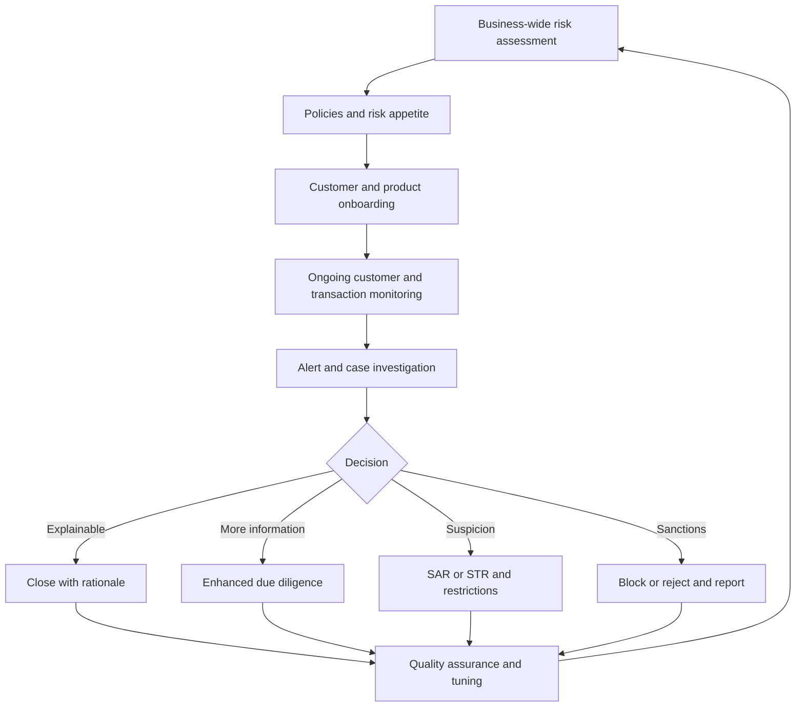
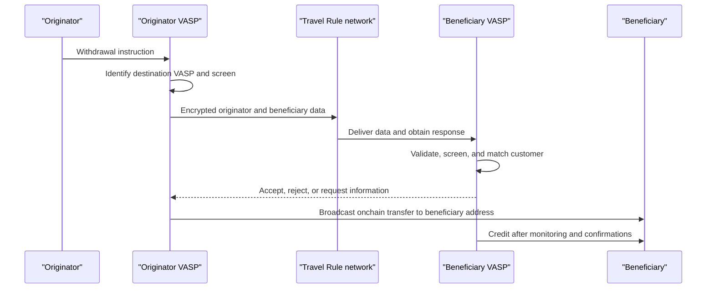
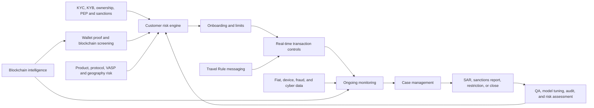

# Crypto AML, Sanctions, and the Travel Rule

## Scope

Anti-money-laundering, counter-terrorist-financing, counter-proliferation, and
sanctions controls apply to activities and legal persons, not to a technology
label. Digital assets create new data and intervention opportunities, but also
new operational problems: self-hosted wallets, irreversible settlement,
cross-chain movement, pseudonymous addresses, programmable contracts, global
access, and fragmented regulation.

This note builds a compliance program from first principles. It explains:

- money laundering and terrorist-financing stages and typologies;
- customer, counterparty, wallet, transaction, and product risk;
- KYC, KYB, beneficial ownership, source of funds, and enhanced due diligence;
- blockchain screening and transaction monitoring;
- sanctions blocking and risk controls;
- the FATF Travel Rule and technical messaging networks;
- self-hosted wallets, DeFi, stablecoins, NFTs, privacy tools, and bridges;
- investigations, suspicious-activity reporting, and evidence;
- model governance, privacy, and operational design; and
- worked examples and control tables.

Rules are jurisdiction-specific and change. The legal sources cited here are
starting points, not legal advice. A production program must be mapped to the
entities, activities, countries, customers, and current law in scope.

## 1. Why Financial-Crime Controls Exist

### 1.1 Money laundering

Money laundering makes criminal proceeds appear usable or legitimate.
Traditional descriptions use three stages:

1. **placement:** proceeds enter a financial channel;
2. **layering:** transactions obscure origin and control; and
3. **integration:** value returns to the economy with an apparently legitimate
   explanation.

Digital assets blur these stages. A ransomware payment may begin natively
onchain, pass through bridges and swaps within minutes, and be cashed out or used
directly without conventional placement.

### 1.2 Terrorist financing

Terrorist financing can involve lawful or unlawful funds. The aim is not
necessarily to disguise criminal origin, but to hide destination, purpose,
network, or beneficiary. Small amounts can be operationally meaningful.

### 1.3 Proliferation financing

Proliferation financing supports development or procurement of weapons of mass
destruction and related materials. It can involve front companies, trade,
shipping, sanctions evasion, procurement agents, cyber theft, and complex
cross-border payment chains.

### 1.4 Fraud, theft, and cybercrime

Crypto services encounter:

- investment and romance scams;
- account takeover;
- phishing and approval theft;
- ransomware;
- protocol exploits;
- insider theft;
- market manipulation;
- darknet commerce;
- mule networks; and
- laundering-as-a-service.

Fraud prevention and AML overlap but differ. Fraud controls protect a customer
or firm from unauthorized loss; AML asks whether the activity involves criminal
property or suspicious financial behavior. One incident may trigger both.

### 1.5 Sanctions

Sanctions restrict dealings with designated persons, entities, vessels,
countries, sectors, or property under a jurisdiction's foreign-policy and
national-security laws. They are not a subset of AML:

- some regimes impose strict prohibitions without requiring knowledge of
  criminal intent;
- funds may need to be blocked rather than rejected;
- ownership and control rules can extend to unlisted entities;
- reporting deadlines differ; and
- licenses and exemptions are regime-specific.

## Section Summary: Objectives and Responses

| Risk | Core question | Typical response |
|---|---|---|
| Money laundering | Are proceeds being disguised or moved for another person? | Investigate, restrict as appropriate, report suspicion |
| Terrorist financing | Are funds supporting designated or violent activity? | Escalate urgently, report, sanctions controls |
| Proliferation financing | Does activity support prohibited procurement or state networks? | Enhanced intelligence, sanctions and trade controls |
| Fraud | Is a customer or firm being deceived or compromised? | Stop loss, secure account, investigate recipient |
| Sanctions | Is a prohibited person, property, jurisdiction, or service involved? | Block or reject according to law, report, preserve property |

## 2. The Risk-Based Approach

A risk-based approach allocates stronger controls to higher risk while preserving
baseline obligations.



### 2.1 Business-wide risk assessment

Assess inherent risk by:

- customers;
- products and services;
- assets and protocols;
- transaction channels;
- geographies;
- counterparties;
- delivery model;
- custody model;
- legal entities; and
- new technology.

Then assess control effectiveness and residual risk.

Example:

```text
Product: institutional spot custody
Inherent risk: high-value cross-border transfers
Controls: KYB, beneficial ownership, whitelisted addresses,
          transaction monitoring, dual approval, source of funds
Residual risk: moderate
```

Risk ratings should not be a multiplication ritual that hides judgment. Define
scales, evidence, override rules, and the action associated with each rating.

### 2.2 Risk appetite

Risk appetite states what the firm will:

- prohibit;
- accept with standard controls;
- accept only with enhanced controls;
- cap or limit;
- monitor specially; or
- escalate for senior approval.

Examples of possible categories:

- sanctioned jurisdictions: prohibited where law requires;
- privacy-enhancing coins: restricted or enhanced due diligence;
- self-hosted wallets: allowed with risk-based verification;
- DeFi protocols: allowlisted by protocol and contract;
- token issuers: require legal and reserve diligence;
- high-risk VASPs: restricted or senior approval.

Policies should describe why, not rely on blanket "crypto risk."

## Section Summary: Risk Hierarchy

| Level | Artifact | Purpose |
|---|---|---|
| Enterprise | Business-wide risk assessment | Identify aggregate exposure |
| Board/senior management | Risk appetite | Define accepted and prohibited risk |
| Product | Product risk assessment | Design controls before launch |
| Customer | Customer risk rating | Set diligence and review frequency |
| Transaction | Rules and models | Detect event-level risk |
| Case | Investigator decision | Resolve facts and suspicion |

## 3. Regulatory Perimeter: Who Is Obliged?

### 3.1 FATF virtual assets and VASPs

The Financial Action Task Force establishes international AML/CFT standards.
Its virtual-asset framework applies Recommendation 15 and other Recommendations
to virtual assets and virtual asset service providers, or VASPs.

Covered activities performed as a business for another person generally include:

- exchange between virtual assets and fiat;
- exchange among virtual assets;
- transfer of virtual assets;
- safekeeping or administration enabling control; and
- participation in and provision of financial services related to an issuer's
  offer or sale.

Countries implement these standards through their own definitions and licenses.
One country may call an entity a VASP, another a crypto-asset service provider,
money transmitter, financial institution, or designated business.

### 3.2 Functional analysis

Classify actual control and flow:

1. Does the business accept value from a person?
2. Does it control or direct transmission?
3. Does it exchange, custody, broker, or arrange?
4. Does it act for itself or for another?
5. Can it unilaterally change or stop the transfer?
6. Is the service a business or occasional own-account activity?
7. Which legal entity performs each step?

A "non-custodial" interface may still operate a controlled router, matching
engine, fee key, upgrade key, or relayer. Conversely, writing open-source code
without operating a service may be treated differently. Facts and jurisdiction
control.

### 3.3 U.S. money transmission example

FinCEN guidance distinguishes users from administrators and exchangers of
convertible virtual currency. Administrators or exchangers accepting and
transmitting value for others can be money transmitters unless an exemption
applies. The 2019 guidance applies existing rules to wallets, exchanges, DApps,
anonymity-enhanced services, payment processors, miners, and business models.

This federal AML classification is separate from:

- state money-transmitter licensing;
- securities or commodities law;
- banking law;
- sanctions;
- consumer protection; and
- tax.

### 3.4 EU framework example

The EU Markets in Crypto-Assets Regulation creates authorization and conduct
requirements for crypto-asset service providers. The recast Transfer of Funds
Regulation, Regulation (EU) 2023/1113, applies information-accompanying
requirements to crypto-asset transfers involving a CASP, including rules for
self-hosted addresses.

The anti-money-laundering package and national supervision add further
requirements. MiCA authorization does not replace AML obligations.

## Section Summary: Activity Before Label

| Service label | Facts that may determine obligation |
|---|---|
| Wallet | Who controls keys, recovery, and transaction submission? |
| DEX | Who controls interface, contracts, routing, fees, and upgrades? |
| Bridge | Who accepts value, controls minting, and operates verification? |
| Stablecoin | Who issues, redeems, administers, and distributes? |
| Broker | Does it arrange, match, execute, or hold customer assets? |
| Validator | Is activity only consensus, or does it provide additional services? |

## 4. Customer Due Diligence

### 4.1 Customer identification

For an individual, collect and verify as required:

- legal name;
- date and place of birth;
- nationality and residence;
- address;
- government identifier;
- identity-document authenticity;
- contact and device information; and
- tax information.

For an entity:

- legal name and form;
- registration number;
- registered and operating addresses;
- formation documents;
- directors and authorized signers;
- ownership and control;
- business activity;
- regulated status;
- expected account purpose;
- source of funds and wealth where appropriate; and
- group and geographic footprint.

### 4.2 Beneficial ownership

The registered shareholder is not always the natural person who ultimately owns
or controls the entity.

Identify:

- ownership above applicable thresholds;
- control through voting, agreements, or appointment rights;
- persons exercising control by other means;
- settlors, trustees, protectors, and beneficiaries for trusts; and
- senior managing official fallback where law permits and no owner is identified.

Token ownership does not replace corporate beneficial-ownership analysis.
A DAO governance token holder may have economic influence but not correspond to
a legally defined beneficial owner of a service entity.

### 4.3 Purpose and expected activity

Record:

- why the customer needs the product;
- expected assets;
- expected counterparties;
- volume and frequency;
- countries;
- wallet types;
- source of funds;
- investment or business strategy; and
- anticipated use of DeFi, bridges, staking, or privacy tools.

Expected activity makes later monitoring contextual. "Large transfer" is not
meaningful without knowing whether the customer is a retail saver or market
maker.

### 4.4 Screening

Screen customer and related parties against:

- sanctions lists;
- politically exposed persons;
- adverse media;
- law-enforcement notices;
- internal fraud and exit lists;
- regulatory warnings; and
- geographic restrictions.

Names require fuzzy matching and transliteration; wallet addresses require exact
matching plus entity and exposure analysis. Neither replaces the other.

### 4.5 Customer risk rating

Example factors:

- jurisdiction;
- occupation or industry;
- legal form and ownership complexity;
- product;
- delivery channel;
- source of wealth;
- PEP status;
- transaction profile;
- self-hosted wallet use;
- high-risk VASP exposure; and
- negative information.

Do not double-count correlated factors. A customer's country may already drive
both geographic and sanctions scores.

### 4.6 Enhanced due diligence

EDD can include:

- additional identity and ownership evidence;
- detailed source of wealth and funds;
- financial statements and bank records;
- wallet ownership proof;
- counterparty explanation;
- protocol or VASP due diligence;
- senior management approval;
- lower limits;
- pre-transaction review;
- more frequent monitoring; and
- enhanced record retention.

EDD is not simply "collect more documents." The added evidence should resolve a
specific risk question.

### 4.7 Ongoing due diligence

Refresh when:

- periodic review is due;
- ownership or directors change;
- behavior departs from expectation;
- sanctions or adverse media change;
- new products or jurisdictions are added;
- wallet control changes; or
- material risk events occur.

## Worked Example: Institutional Fund Onboarding

A Cayman fund seeks custody and execution.

1. Verify fund, manager, administrator, directors, and regulated status.
2. Identify beneficial owners or controlling persons according to applicable
   fund rules.
3. Understand strategy, investors, expected assets, venues, and leverage.
4. Obtain source-of-assets evidence from prior custodians and exchanges.
5. Verify authorized wallets using signed messages or controlled test transfers.
6. Screen wallets historically and continuously.
7. Assess external manager, prime broker, OTC desks, and DeFi protocols.
8. Set expected volumes and withdrawal controls.
9. Escalate unexplained mixer exposure or rapid third-party funding.
10. Preserve rationale and set review triggers.

## Section Summary: Due-Diligence Layers

| Layer | Object | Key question |
|---|---|---|
| KYC/KYB | Legal customer | Who is the customer? |
| Beneficial ownership | Natural persons/control | Who ultimately owns or controls it? |
| Purpose | Relationship | Why is the service used? |
| Source of funds | Specific value | Where did this transaction's assets come from? |
| Source of wealth | Economic history | How was overall wealth generated? |
| Wallet proof | Technical control | Does the customer control this address? |
| Counterparty diligence | External VASP/protocol | Who is on the other side and how is it controlled? |

## 5. Wallet Ownership and Control

### 5.1 Proof methods

Methods include:

- sign a challenge with the wallet key;
- send a unique small amount;
- receive a transfer from the address;
- connect and sign through a wallet;
- obtain custodian or VASP confirmation;
- verify account screenshot and statement; or
- inspect smart-account owners and authorization.

### 5.2 Limits of a signature

A valid signature proves control of a key at a time. It does not prove:

- beneficial ownership of funds;
- exclusive control;
- absence of delegated signers;
- lawful source;
- future control;
- identity of a smart-contract owner; or
- control of every address in a cluster.

For a multisignature, verify threshold, owners, modules, guards, upgradeability,
and signer entities. For an exchange deposit address, the customer may be able to
instruct withdrawals without controlling the address key.

### 5.3 Self-hosted wallets

A self-hosted wallet is not inherently illicit. It removes a regulated
intermediary from one side and therefore changes available information and
intervention.

Risk controls can include:

- ownership or control verification;
- address and exposure screening;
- transaction purpose;
- source of funds;
- value and frequency thresholds;
- device and account security;
- counterparty explanation;
- enhanced review for third-party wallets; and
- post-transfer monitoring.

Blanket prohibition may push activity outside visibility; unrestricted access
may exceed risk appetite. Use jurisdiction-specific rules.

## Section Summary: Wallet Evidence

| Evidence | Proves | Does not prove |
|---|---|---|
| Signed challenge | Key control | Legal ownership or lawful funds |
| Test transfer | Ability to send | Exclusive control |
| Custodian letter | Account relationship | Every onchain source |
| Blockchain cluster | Probable common control | Named beneficial owner without attribution |
| Customer declaration | Stated ownership | Independent verification |
| Multisig inspection | Onchain threshold and owners | Identity behind every key |

## 6. Blockchain Screening

### 6.1 Direct attribution

An address may be linked to:

- sanctioned person;
- exchange;
- mixer;
- scam;
- ransomware;
- theft;
- darknet market;
- bridge;
- DeFi protocol;
- mining pool; or
- merchant.

Evidence and confidence matter. "Direct sanctions match" is not the same as
"behavior resembles a mixer."

### 6.2 Exposure

Exposure is a relationship, not a substance that physically coats a token.
Sending directly to a designated address is categorically different from
receiving funds several hops after they passed through a large omnibus exchange.
Distance, direction, proportion, elapsed time, and the type of intermediary all
change the evidential meaning. A policy must therefore translate graph proximity
into an explicitly bounded risk decision.

Exposure can be:

- direct ownership;
- direct counterparty;
- one or more indirect hops;
- proportional source of funds;
- destination exposure;
- cluster exposure; or
- behavioral association.

A risk policy should define:

- direction;
- distance;
- amount or percentage;
- time window;
- risk category;
- attribution confidence;
- service intermediary treatment;
- chain; and
- customer context.

### 6.3 Taint allocation

Suppose a wallet receives 10 illicit units and 90 clean units, then sends 20.

Different methods say:

```text
Poison:
all 20 treated as exposed

Proportional haircut:
2 of 20 treated as exposed

FIFO:
depends on transaction ordering; possibly first 10 exposed

Specific tracing:
uses UTXO or transaction path where separable
```

No method is universally legally correct. The program should document its
method and avoid presenting risk allocation as physical identity of coins.

### 6.4 Service intermediaries

Funds passing through a large exchange cannot usually be traced mechanically
from one deposit to a particular withdrawal because the exchange uses omnibus
wallets and internal books. Vendor heuristics may infer links, but legal process
or exchange records often provide the reliable connection.

### 6.5 Smart contracts

A transfer to a contract may be:

- swap;
- loan deposit;
- bridge;
- staking;
- token approval;
- NFT purchase;
- liquidity provision;
- governance;
- exploit; or
- proxy call.

Monitoring needs decoded calls, events, asset flows, and contract semantics.
Counting the contract as the final beneficial counterparty is often wrong.

## Worked Example: DEX Swap after Theft

An attacker steals Token A, swaps through an aggregator into Token B, bridges to
another chain, and deposits at an exchange.

The investigation should:

1. identify the victim transaction and ownership evidence;
2. decode the aggregator's internal calls;
3. trace Token A into pool reserves;
4. identify Token B outputs net of fees;
5. map the bridge source message to destination mint;
6. record whether that mapping is deterministic or heuristic;
7. trace the destination token to the exchange deposit;
8. send a preservation or freeze request through lawful channels;
9. avoid labeling unrelated pool liquidity providers as thieves; and
10. preserve transaction hashes, timestamps, prices, and attribution versions.

## Section Summary: Screening Signal Strength

| Signal | Typical confidence | Suitable use |
|---|---:|---|
| Exact listed sanctions address | High as address match; ownership rules still matter | Immediate sanctions escalation |
| Ground-truth service attribution | High | Counterparty classification |
| Clustered address | Medium to high depending on heuristic | Investigation and monitored decision |
| One-hop exposure | Context dependent | Risk alert |
| Multi-hop exposure | Lower as distance and services increase | Prioritization, not automatic guilt |
| Behavioral typology | Model dependent | Investigation lead |

## 7. Transaction Monitoring

### 7.1 Pre-transaction versus post-transaction

Pre-transaction screening can:

- stop outgoing withdrawal;
- hold deposit credit;
- require review;
- enforce allowlists; or
- prevent contract interaction.

Post-transaction monitoring can:

- detect later attribution;
- identify customer pattern;
- follow funds;
- trigger account restriction;
- support suspicious-activity reporting; and
- refresh risk.

Irreversibility makes pre-screening valuable, but source attribution may emerge
only later.

### 7.2 Rule families

#### Counterparty rules

- direct sanctions;
- high-risk or unlicensed exchange;
- mixer;
- darknet;
- gambling;
- ransomware;
- scam;
- terrorist-financing designation.

#### Behavioral rules

Behavioral monitoring asks whether the transaction sequence has a structure
associated with concealment, fraud, or rapid dissipation. None of these patterns
is inherently criminal: a market maker can have high velocity and a bridge user
can legitimately change chains. The rule creates a reason to investigate when
the pattern is inconsistent with the customer, product, and economic purpose.

- rapid in-and-out;
- many unrelated senders;
- structured transfers;
- chain hopping;
- repeated bridge use;
- newly created wallets;
- dormant wallet reactivation;
- high velocity;
- unusual asset conversion;
- peel chain;
- circular flow;
- self-transfer designed to obscure.

#### Customer-deviation rules

- volume exceeds stated business;
- new country or asset;
- new self-hosted wallet;
- sudden DeFi activity;
- third-party funding;
- unexpected OTC counterparty;
- withdrawal immediately after fiat deposit.

#### Product-specific rules

- stablecoin mint or redeem inconsistent with role;
- NFT wash trading;
- staking rewards inconsistent with holdings;
- DeFi liquidation or flash-loan exploit;
- bridge transfer without expected destination receipt;
- token contract with honeypot or scam behavior.

### 7.3 Rule construction

A good rule specifies:

```text
population
event
condition
threshold
time window
exclusions
risk severity
evidence
required action
```

Example:

```text
Population: retail customers
Event: outgoing transfer to self-hosted wallet
Condition: indirect ransomware exposure within 2 hops
Threshold: exposed value > 5% and > 1,000 units
Window: source funds received within 30 days
Exclusions: regulated exchange intermediary with no attributable link
Action: hold for enhanced review
```

### 7.4 Alert aggregation

One transaction may trigger ten related rules. Case systems should group alerts
by customer, wallet, counterparty, and episode so analysts see a coherent story.

### 7.5 Tuning

Measure:

- alert volume;
- true-positive and false-positive rate;
- analyst handling time;
- backlog age;
- conversion to EDD, restriction, or report;
- missed known cases;
- segment and demographic impact;
- model drift; and
- reason for closure.

Reducing alerts is not success if detection collapses. Increasing alerts is not
success if analysts cannot investigate them.

## Section Summary: Monitoring Design

| Layer | Example | Main risk if missing |
|---|---|---|
| Exact lists | Sanctioned address | Prohibited transaction |
| Attribution | High-risk VASP | Counterparty blind spot |
| Exposure | Funds from ransomware cluster | Indirect illicit proceeds |
| Behavior | Rapid bridge and swap chain | Unknown actors not yet labeled |
| Customer context | Activity exceeds expected profile | Generic rules miss anomaly |
| Cross-channel | Fiat deposit then crypto withdrawal | Onchain and offchain stages disconnected |

## 8. Sanctions Compliance

### 8.1 Program elements

A sanctions program joins legal interpretation to transaction operations. List
screening identifies explicit names and addresses, ownership analysis extends
restrictions to controlled entities, and escalation determines whether property
must be blocked, a transfer rejected, or activity merely reviewed. Training and
testing matter because a technically correct match is useless if staff route it
to the wrong legal action.

A sanctions program includes:

- risk assessment;
- management commitment;
- internal controls;
- testing and audit;
- training;
- list and geographic screening;
- wallet and entity intelligence;
- ownership and control analysis;
- escalation;
- blocking or rejection;
- reporting;
- licenses and exemptions; and
- recordkeeping.

### 8.2 Address lists are incomplete

Sanctions authorities may publish digital-currency addresses, but:

- designated persons create new addresses;
- entities owned by blocked persons may be blocked without listing;
- exchanges use changing deposit infrastructure;
- smart contracts and protocols complicate control;
- addresses can receive unsolicited dust; and
- attribution can be wrong.

Use address lists as strong indicators, not the whole program.

### 8.3 Ownership and control

Some regimes block entities owned 50% or more, directly or indirectly, by one or
more blocked persons. Other regimes use different ownership or control tests.

For a DAO or protocol, analyze:

- legal entity;
- equity ownership;
- governance rights;
- administrator keys;
- multisig signers;
- fee beneficiaries;
- operational control;
- front-end control; and
- ability to change or stop contracts.

Token voting percentage alone may not answer legal ownership.

### 8.4 Block versus reject

- **blocking/freezing:** prevent transfer, place property in a blocked status,
  report, and do not return it without authorization;
- **rejecting:** decline the transaction without taking possession, where rules
  require rejection rather than blocking.

The distinction is legally specific. A smart contract cannot always reverse a
transfer, so custody and contract design must support required controls.

### 8.5 Stablecoin freezes

Centralized stablecoin issuers can freeze addresses or burn and reissue under
contract and legal powers. This can support sanctions enforcement and stolen-fund
recovery, but:

- action depends on issuer jurisdiction and policy;
- frozen tokens may remain visible onchain;
- DeFi pools may hold mixed frozen and unfrozen claims;
- wrapped versions add intermediaries;
- a freeze can affect innocent counterparties; and
- forks or unsupported chains create ambiguity.

### 8.6 Geographic controls

IP addresses, device location, phone, bank account, identity document, and
blockchain behavior can indicate geography. VPNs and false documents reduce
certainty. Combine signals and define escalation.

## Worked Example: Exact OFAC Address Match

A U.S. custodian receives a deposit from an address listed by OFAC.

1. Prevent customer use of the received property.
2. Confirm exact chain, address, asset, and list entry.
3. Preserve the transaction and list version.
4. Determine whether the property is in possession or control and whether
   blocking applies.
5. Identify customer, beneficial owner, and surrounding transactions.
6. Notify sanctions counsel and designated compliance authority.
7. File required blocking and other reports within applicable deadlines.
8. Keep property segregated and controlled.
9. Do not return or move it without license or authority.
10. Assess prior exposure and control failure.

The exact process depends on jurisdiction and facts.

## Section Summary: Sanctions Controls

| Control | Detects | Limitation |
|---|---|---|
| Name screening | Listed customer or owner | Alias and ownership complexity |
| Address screening | Listed wallet | New addresses and false deposits |
| Entity clustering | Unlisted addresses of known actor | Heuristic error |
| IP/geolocation | Restricted location | VPN and travel |
| Ownership analysis | Unlisted blocked entity | Offchain corporate data needed |
| Transaction monitoring | Evasion behavior | Suspicion, not legal designation |
| Issuer freeze | Stops supported token movement | Centralized power and chain scope |

## 9. The FATF Travel Rule

### 9.1 Purpose

The Travel Rule requires originator and beneficiary information to accompany
qualifying virtual-asset transfers between obliged institutions. It aims to make
value transfers traceable in a way analogous to wire transfers.

It does not mean putting personal data on a public blockchain.

### 9.2 Information

Exact required fields and thresholds vary by jurisdiction. Common fields include:

Originator:

- name;
- account or wallet identifier;
- address, national identity number, customer number, or date and place of birth,
  depending on law; and
- originating VASP.

Beneficiary:

- name;
- account or wallet identifier; and
- beneficiary VASP.

The originating VASP collects and verifies required originator information and
transmits it securely. The beneficiary VASP checks completeness, applies risk
controls, and retains records.

### 9.3 Data and asset flows



Personal data travels through a secure offchain channel; the asset travels
onchain. They must be correlated through an identifier without leaking personal
data publicly.

### 9.4 Counterparty VASP discovery

An address does not state whether it belongs to a VASP. Discovery methods:

- customer declaration;
- blockchain attribution;
- VASP directories;
- Travel Rule network lookup;
- counterparty messaging;
- domain or certificate proof;
- prior verified relationship; and
- beneficiary name matching.

Misidentifying a self-hosted address as a VASP can leak personal data to the
wrong party.

### 9.5 Messaging protocols and networks

The Travel Rule specifies information that regulated parties must obtain and
transmit, but it does not prescribe one global communication network. Providers
have consequently built several discovery and encrypted-messaging systems.
Interoperability is difficult because a VASP must first identify the
counterparty, determine whether it participates in a reachable network, verify
its legal identity, and send data under compatible privacy rules before or
alongside the asset transfer.

Implementations include:

- TRISA;
- OpenVASP;
- Travel Rule Universal Solution Technology, or TRUST;
- Sygna;
- Notabene;
- VerifyVASP;
- GTR and other provider networks; and
- bilateral APIs.

They differ in:

- discovery;
- identity certificates;
- message schema;
- encryption;
- consent and data protection;
- reach;
- interoperability;
- workflow;
- sanctions checks;
- self-hosted wallet support; and
- governance.

### 9.6 IVMS101

The InterVASP Messaging Standard IVMS101 provides a common data model for
originator and beneficiary information. A common schema reduces semantic
mismatch but does not itself provide:

- transport;
- counterparty authentication;
- legal basis;
- field verification;
- sanctions compliance; or
- network interoperability.

### 9.7 Sunrise problem

Jurisdictions implemented the rule at different times and with different
thresholds. One VASP may be obliged while its counterparty is not.

A policy should define:

- whether to proceed;
- minimum data to collect;
- enhanced review;
- counterparty risk;
- record of attempted transmission;
- restrictions for repeated non-cooperation; and
- country-specific treatment.

FATF's 2025 targeted update reported 99 jurisdictions had passed or were in the
process of passing Travel Rule legislation, but implementation effectiveness
remained uneven.

### 9.8 EU self-hosted address rule

EU Regulation 2023/1113 applies where a CASP is involved in a transfer to or from
a self-hosted address. The CASP collects originator and beneficiary information
from its client. For a transfer above EUR 1,000 to or from a self-hosted address
on behalf of its client, the Regulation requires verification that the client
owns or controls that address.

This does not create a universal global rule that every self-hosted wallet owner
must be identified by every other user.

### 9.9 Data protection

Travel Rule compliance creates a sensitive offchain identity graph next to a
public transaction graph. If the data leaks, an attacker may learn both who owns
an address and how much value it controls. Collecting excessive information
“just in case” can therefore increase physical, cyber, and privacy risk without
improving the required transfer record.

Travel Rule data is sensitive. Risks include:

- breach exposing crypto holders;
- physical targeting;
- excessive network-wide sharing;
- incorrect counterparty;
- long retention;
- cross-border transfer restrictions;
- mismatch with blockchain immutability; and
- correlation across VASPs.

Apply:

- data minimization;
- purpose limitation;
- encryption;
- mutual authentication;
- access control;
- retention schedules;
- breach response;
- vendor due diligence;
- regional routing; and
- audit logs.

## Worked Example: VASP-to-VASP Withdrawal

A customer requests 2 BTC to an address at Exchange B.

1. Exchange A authenticates the customer and withdrawal.
2. It identifies Exchange B through customer input, attribution, and directory.
3. It screens customer, beneficiary, Exchange B, and address.
4. It creates an IVMS101-compatible payload.
5. It transmits data through an authenticated Travel Rule channel.
6. Exchange B matches beneficiary name and account.
7. Exchange B accepts or requests correction.
8. Exchange A broadcasts only after policy conditions are met.
9. Both correlate the blockchain transaction hash with the Travel Rule message.
10. Both retain required records and monitor the transfer.

## Section Summary: Travel Rule Control Points

| Stage | Control | Failure example |
|---|---|---|
| Destination identification | VASP discovery | Personal data sent to wrong firm |
| Counterparty trust | Certificate and entity diligence | Spoofed VASP |
| Payload | Complete verified fields | Missing beneficiary |
| Privacy | Encryption and access control | Customer data breach |
| Correlation | Message/transaction identifier | Wrong transfer matched |
| Decision | Accept/reject/request logic | Assets sent before refusal |
| Recordkeeping | Immutable audit link | Cannot prove compliance |

## 10. DeFi and Decentralized Systems

### 10.1 Protocol versus service

Separate:

- immutable smart contracts;
- developers;
- governance;
- foundation;
- front end;
- hosted API;
- relayer;
- sequencer;
- fee recipient;
- admin multisig;
- liquidity providers; and
- users.

Legal obligations may attach differently. Technical decentralization is not a
binary exemption.

### 10.2 Permissioned pools and hooks

DeFi can implement:

- allowlisted wallets;
- credential proofs;
- transfer restrictions;
- sanctioned-address blocks;
- risk-scored front ends;
- permissioned liquidity pools;
- withdrawal delays;
- circuit breakers; and
- issuer-controlled asset freezes.

These controls can be bypassed through another interface if the core contracts
are permissionless. State clearly which layer is controlled.

### 10.3 Compliance without public identity

Privacy-preserving credentials attempt to separate eligibility from identity
disclosure. A smart contract may only need to know that a wallet passed an
approved KYC process and belongs to an eligible jurisdiction, while the credential
issuer retains identity evidence for lawful access. This reduces public data
exposure but shifts trust to credential issuance, revocation, and wallet binding.

Selective-disclosure credentials can prove:

- KYC completed by a trusted issuer;
- jurisdiction allowed;
- not sanctioned at issuance time;
- investor qualification;
- credential not revoked.

Challenges:

- credential sharing;
- freshness;
- issuer trust;
- revocation;
- sanctions updates;
- legal access to identity;
- cross-protocol standards; and
- wallet transfer or compromise.

### 10.4 Protocol monitoring

A protocol team can monitor:

- exploit patterns;
- sanctioned interactions;
- governance attacks;
- oracle anomalies;
- flash-loan behavior;
- liquidity drainage;
- bridge compromise; and
- front-end abuse.

Intervention powers should be documented. Monitoring without an authorized and
tested response path produces alerts but no control.

## Section Summary: DeFi Control Layers

| Layer | Possible control | Bypass or limitation |
|---|---|---|
| Front end | Geoblock and wallet screening | Direct contract call |
| Smart contract | Allowlist or pause | Governance/admin compromise |
| Asset issuer | Freeze or denylist | Different asset or wrapper |
| Relayer/sequencer | Transaction policy | Alternate submission path |
| Liquidity provider | Counterparty policy | Permissionless pool |
| Credential | Proof of eligibility | Stale or transferred credential |

## 11. Asset- and Protocol-Specific Typologies

### 11.1 Stablecoins

Typologies:

- rapid mint-transfer-redeem;
- cross-chain burn and mint;
- sanctioned or scam proceeds;
- OTC cash conversion;
- layering through multiple issuers;
- use as settlement after theft;
- depeg exploitation; and
- mule wallets.

Controls should connect issuer, exchange, chain, bridge, and fiat redemption.

### 11.2 Bridges

Bridging changes the representation and often the chain, but not necessarily the
economic owner. A trace should link the source event to the destination event and
state whether that linkage is deterministic or inferred. Treating the bridge pool
as the final destination hides rapid chain hopping; assuming every similar amount
is linked can falsely connect unrelated users in a liquidity bridge.

Bridges break naive traces. Monitor:

- source lock or burn;
- message and destination mint;
- amount net of fees;
- route and bridge version;
- liquidity-provider fulfillment;
- destination address;
- rapid repeated hopping; and
- bridge exploit or pause.

### 11.3 Mixers and privacy-enhancing tools

Use may indicate:

- legitimate privacy;
- salary or donation confidentiality;
- avoidance of public commercial surveillance;
- laundering;
- sanctions evasion; or
- theft obfuscation.

Analyze amount, timing, customer explanation, source, destination, jurisdiction,
and surrounding behavior. A single category label is not a complete case.

### 11.4 NFTs

Risks:

- wash trading;
- self-funded purchases;
- manipulated floor prices;
- stolen NFT resale;
- royalty laundering;
- fake collections;
- phishing approvals; and
- high-value subjective pricing.

Trace both NFT ownership and payment, marketplace fees, related wallets, and
offchain sale agreements.

### 11.5 Mining, staking, and validators

Questions:

- source of stake;
- reward address;
- delegation and beneficial owner;
- validator sanctions status;
- MEV and fee income;
- pool participants;
- slashing and withdrawals; and
- whether rewards commingle funds.

Newly mined coins are not automatically low risk if mining service ownership or
jurisdiction is sanctioned.

### 11.6 OTC desks and brokers

Risks include:

- undisclosed principal;
- cash settlement;
- nested services;
- weak KYC;
- third-party payments;
- informal brokers;
- high-risk jurisdiction;
- exchange account rental; and
- rapid stablecoin turnover.

Due diligence should identify who performs KYC, holds assets, sets price, and
settles fiat.

## Section Summary: Typology Signals

| Context | Stronger suspicious pattern | Possible benign explanation |
|---|---|---|
| Mixer | Stolen funds enter immediately and exit to mule exchange accounts | Long-standing privacy practice with documented funds |
| Bridge | Multiple rapid hops after exploit | Treasury rebalancing |
| NFT | Related wallets trade same item at escalating prices | Genuine collector transfer |
| Stablecoin | Third-party cash, immediate mint and external redeem | Market-maker inventory |
| Staking | Rewards to unrelated high-risk wallet | Delegated operator fee |
| OTC | Many customers through one exchange account | Disclosed regulated omnibus model |

## 12. Investigations and Suspicious-Activity Reporting

### 12.1 Alert is not suspicion

An alert indicates a rule condition. An investigation combines:

- customer profile;
- blockchain trace;
- fiat and account activity;
- device and authentication;
- counterparties;
- source and destination of funds;
- explanation and documents;
- external intelligence;
- typology; and
- legal context.

### 12.2 Investigation workflow

An investigation converts heterogeneous signals into a documented judgment. The
order matters: analysts first preserve evidence and validate parsing so a vendor
label or decoding error does not contaminate the case. They then connect the
onchain flow to the known customer and offchain facts, seek an explanation when
appropriate, and decide whether the combined evidence is suspicious under the
applicable legal standard.

1. triage urgency and sanctions/fraud risk;
2. preserve data;
3. validate transaction parsing;
4. confirm attribution and confidence;
5. trace material flows;
6. link wallets to customer and counterparties;
7. compare expected activity;
8. request information where permitted;
9. assess explanation;
10. decide and document;
11. report and restrict where required;
12. monitor subsequent movement.

### 12.3 Writing a SAR or STR

A useful narrative explains:

- who;
- what;
- when;
- where;
- why suspicious;
- how value moved;
- total amount and assets;
- wallet addresses and transaction hashes;
- entities and attribution basis;
- customer explanation;
- action taken; and
- contact for supporting records.

Do not paste an unreadable transaction graph without explaining it.

### 12.4 Confidentiality

Suspicious-activity reports and their existence are highly confidential under
many regimes. Access, case notes, vendor sharing, and customer communications
must respect tipping-off prohibitions.

### 12.5 Asset preservation

Possible actions:

- internal hold;
- withdrawal restriction;
- issuer freeze;
- counterparty preservation request;
- law-enforcement referral;
- court order;
- blocked-property account;
- emergency incident coordination.

Authority differs. A private firm should not seize merely because analytics show
risk.

## Worked Example: Romance-Scam Mule

A new customer receives stablecoins from 20 unrelated wallets and sends them
daily to one offshore exchange.

Investigation:

1. customer expected profile is low-volume personal investment;
2. senders have reports of scam victimization;
3. device and login show remote-control software;
4. transfers are quickly consolidated with a fixed commission retained;
5. customer claims to process funds for an online employer;
6. no credible business or contracts exist;
7. offshore beneficiary is linked to other mule clusters.

The suspicion arises from the total pattern—third-party funds, rapid
pass-through, victim links, implausible purpose—not merely the offshore exchange.

## Section Summary: Evidence Hierarchy

| Evidence | Weight |
|---|---|
| Customer records and signed instructions | Direct relationship evidence |
| Blockchain transaction and verified contract decoding | Direct technical evidence |
| Ground-truth attribution | Strong counterparty evidence |
| Heuristic cluster | Investigative evidence requiring confidence |
| Behavioral model | Prioritization and contextual evidence |
| Customer explanation with documents | Can resolve or deepen suspicion |
| Unverified social-media allegation | Lead requiring corroboration |

## 13. Governance, Testing, and Operations

### 13.1 Three lines

A common model:

- first line owns customer and transaction controls;
- second line sets policy, advises, monitors, and challenges;
- third line independently audits design and effectiveness.

Roles should be adapted to organizational size without eliminating independence.

### 13.2 Vendor governance

Analytics vendors provide important data and models, but the regulated firm
retains responsibility for its decision. Labels change as investigations develop,
chain support can lag new token standards, and two products may calculate exposure
differently. Vendor governance makes those limitations testable and preserves
enough evidence to reconstruct why a historical decision was made.

For blockchain analytics:

- document exact licensed data;
- validate before use;
- receive attribution changes;
- preserve historical labels;
- challenge false attribution;
- test chain parsing;
- manage outages;
- export evidence;
- review model changes; and
- avoid automatic account closure from a score alone.

### 13.3 Quality assurance

Quality assurance tests whether analysts apply the policy consistently and
support decisions with sufficient evidence. Sampling only escalated cases misses
false negatives in closed alerts, while sampling only errors gives no estimate of
ordinary performance. Samples should cover products, risk levels, reviewers, and
time periods and feed specific corrections back into training and rules.

Review samples of:

- closed alerts;
- escalated cases;
- sanctions decisions;
- Travel Rule exceptions;
- customer risk overrides;
- self-hosted-wallet verification;
- SAR narratives; and
- delayed cases.

### 13.4 Independent testing

Quality assurance checks individual cases; independent testing asks whether the
program as a whole is designed and operating effectively. Independence is
important because the team that chose a threshold or accepted a data limitation
may normalize it. Testing should trace sample transactions from raw chain data
through alert, investigation, decision, report, and retained evidence.

Test:

- risk assessment;
- customer files;
- sanctions list updates;
- wallet screening;
- monitoring rules;
- data completeness;
- model validation;
- case workflow;
- reporting timeliness;
- Travel Rule transmission;
- data protection;
- training; and
- remediation.

### 13.5 Metrics

Useful metrics:

- onboarding rejection and EDD rate;
- alerts per customer and transaction;
- alert aging;
- true/false-positive estimate;
- investigations by outcome;
- sanctions blocks and near misses;
- SAR/STR timeliness;
- Travel Rule exception rate;
- vendor/API availability;
- unsupported asset volume;
- model changes;
- QA error rate;
- repeat findings; and
- funds frozen or customer losses prevented, carefully defined.

Metrics can be gamed. Low alerts may mean clean business or weak rules.

## Section Summary: Control Assurance

| Assurance | Owner | Question |
|---|---|---|
| Operational check | First line | Did the control run? |
| Compliance monitoring | Second line | Is the control designed and used correctly? |
| Model validation | Independent specialist | Does the model perform as claimed? |
| Internal audit | Third line | Is the framework effective and governed? |
| Regulatory examination | Supervisor | Does the entity meet legal obligations? |

## 14. End-to-End Control Architecture



The architecture should maintain one customer and case identity across fiat and
crypto systems. Siloed wallet alerts cannot detect the complete laundering path.

## 15. Comprehensive Implementation Checklist

### Governance

- accountable board and senior manager;
- approved risk appetite;
- current enterprise and product risk assessments;
- independent compliance authority;
- escalation and reporting;
- audit and remediation.

### Customer

- KYC/KYB;
- beneficial ownership;
- purpose and expected activity;
- PEP, sanctions, and adverse media;
- risk rating;
- EDD;
- periodic and event-driven refresh.

### Wallet and counterparty

- ownership proof;
- address and entity screening;
- self-hosted-wallet policy;
- VASP due diligence;
- source and destination of funds;
- cross-chain provenance.

### Transactions

- pre- and post-transaction monitoring;
- smart-contract decoding;
- customer-context rules;
- fiat and device integration;
- sanctions action;
- Travel Rule;
- alert aggregation.

### Investigation

- evidence preservation;
- attribution confidence;
- tracing method;
- customer explanation;
- decision rationale;
- SAR/STR;
- law-enforcement and freeze procedures;
- confidentiality.

### Technology

- chain and asset completeness;
- vendor validation;
- API resilience;
- model governance;
- data privacy;
- access control;
- business continuity;
- historical replay.

## 16. Key Takeaways

1. AML, sanctions, fraud, terrorist financing, and proliferation financing
   overlap but require different legal decisions and responses.
2. Start with the activity and control of value, not labels such as
   "non-custodial" or "decentralized."
3. KYC identifies the customer; wallet signatures prove only technical control;
   blockchain analytics supplies probabilistic counterparty intelligence.
4. Indirect exposure is not guilt. Direction, value, time, service
   intermediaries, allocation method, and customer context determine relevance.
5. Smart-contract decoding and cross-chain linkage are necessary for modern
   monitoring.
6. Sanctions obligations can require blocking even without money-laundering
   suspicion, and address lists alone are incomplete.
7. The Travel Rule moves personal information securely offchain while assets
   move onchain; counterparty discovery and privacy are core technical problems.
8. Self-hosted wallets are a risk factor and information gap, not inherently
   illicit.
9. DeFi controls must state whether they operate at the front end, asset,
   contract, relayer, credential, or governance layer.
10. Alerts and model scores require investigation, documented evidence, and
    human accountability.
11. A defensible program connects customer, fiat, device, wallet, protocol, and
    Travel Rule data in one case model.
12. Continuous validation is essential because chains, typologies, sanctions,
    vendor labels, and regulations change.

## Related Notes

- [Financial Regulation, Compliance, and Accounting](../../01-financial-foundations/03-risk-and-regulatory-foundations/financial-regulation-compliance-and-accounting.md)
- [Blockchain Analytics](blockchain-analytics.md)
- [Chainalysis and Elliptic](chainalysis-and-elliptic.md)
- [TRM Labs, Merkle Science, and the Analytics Landscape](trm-labs-merkle-science-and-analytics-landscape.md)
- [Digital-Asset Regulation](../02-regulation/digital-asset-regulation.md)
- [Privacy and Confidential Computing for Blockchains](../../06-interoperability-privacy-and-enterprise-dlt/02-privacy/privacy-and-confidential-computing-for-blockchains.md)
- [Stablecoins](../../05-digital-money-and-tokenization/01-stablecoins/stablecoins.md)

## References

- Financial Action Task Force, [Updated Guidance for a Risk-Based Approach to Virtual Assets and VASPs](https://www.fatf-gafi.org/en/publications/Fatfrecommendations/Guidance-rba-virtual-assets-2021.html)
- Financial Action Task Force, [2025 Targeted Update on Virtual Assets and VASPs](https://www.fatf-gafi.org/en/publications/Fatfrecommendations/targeted-update-virtual-assets-vasps-2025.html)
- Financial Action Task Force, [Virtual Assets Red Flag Indicators](https://www.fatf-gafi.org/en/publications/Methodsandtrends/Virtual-assets-red-flag-indicators.html)
- Financial Action Task Force, [FATF Recommendations](https://www.fatf-gafi.org/en/publications/Fatfrecommendations/Fatf-recommendations.html)
- Global Digital Finance, [IVMS101 interVASP messaging standard](https://www.gdf.io/ivms-101/)
- European Union, [Regulation (EU) 2023/1113 on information accompanying transfers of funds and crypto-assets](https://eur-lex.europa.eu/eli/reg/2023/1113/oj/eng)
- European Banking Authority, [Travel Rule Guidelines](https://www.eba.europa.eu/activities/single-rulebook/regulatory-activities/anti-money-laundering-and-countering-financing-terrorism/guidelines-information-requirements-relation-transfers-funds-and-certain-crypto-assets)
- FinCEN, [Application of FinCEN's Regulations to Persons Administering, Exchanging, or Using Virtual Currencies](https://www.fincen.gov/resources/statutes-regulations/guidance/application-fincens-regulations-persons-administering)
- FinCEN, [Application of FinCEN's Regulations to Certain Business Models Involving Convertible Virtual Currencies](https://www.fincen.gov/resources/statutes-regulations/guidance/application-fincens-regulations-certain-business-models)
- FinCEN, [Advisory on Illicit Activity Involving Convertible Virtual Currency](https://www.fincen.gov/sites/default/files/advisory/2019-05-10/FinCEN%20Advisory%20CVC%20FINAL%20508.pdf)
- U.S. Treasury OFAC, [Sanctions Compliance Guidance for the Virtual Currency Industry](https://ofac.treasury.gov/media/913571/download)
- U.S. Treasury OFAC, [Framework for OFAC Compliance Commitments](https://ofac.treasury.gov/media/16331/download)
- U.S. Department of Justice, [Cryptocurrency Enforcement Framework](https://www.justice.gov/archives/ag/page/file/1326061/download)
- Basel Committee on Banking Supervision, [Sound management of risks related to money laundering and financing of terrorism](https://www.bis.org/bcbs/publ/d505.htm)
- Wolfsberg Group, [Guidance on a Risk-Based Approach for Managing Money Laundering Risks](https://wolfsberg-group.org/resources)
- TRISA, [Travel Rule Information Sharing Architecture](https://trisa.io/)
- OpenVASP, [Protocol](https://www.openvasp.org/)
- Coinbase, [TRUST Travel Rule solution](https://www.coinbase.com/travelrule)
- W3C, [Verifiable Credentials Data Model](https://www.w3.org/TR/vc-data-model-2.0/)
