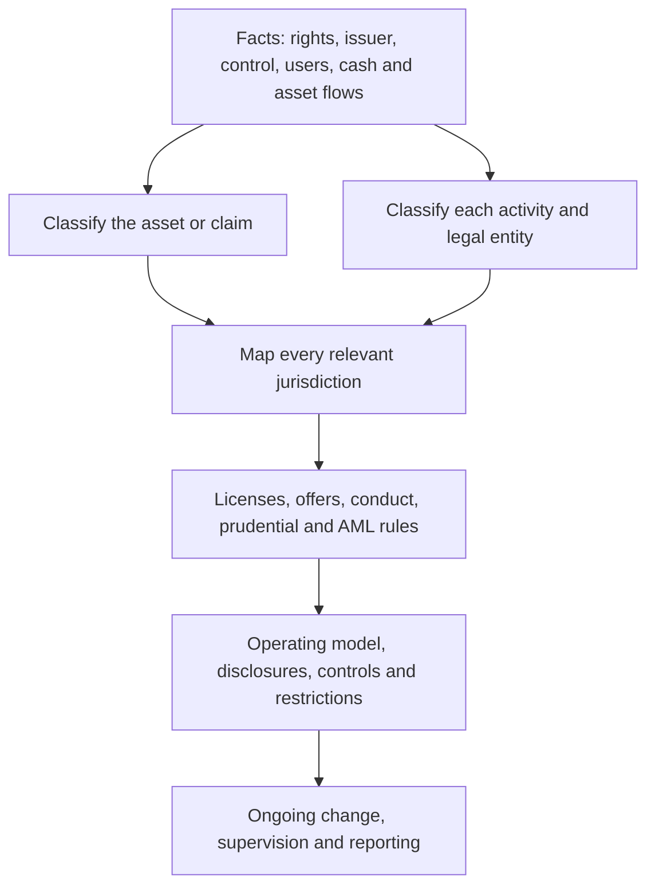
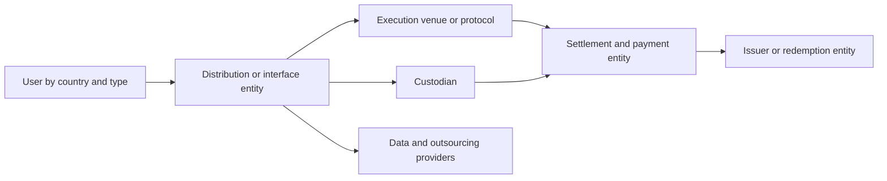

# Digital-Asset Regulation

## Scope and Method

Digital-asset regulation is not one body of law. A single token or service can
simultaneously implicate securities, commodities, derivatives, banking,
payments, e-money, custody, AML, sanctions, consumer protection, tax, data,
insolvency, and operational-resilience rules.

This note provides a method for classifying assets and activities before
surveying major frameworks. It covers:

- technology-neutral legal analysis;
- securities and investment-contract treatment;
- commodities and derivatives;
- payment stablecoins and e-money;
- exchanges, brokers, custody, lending, staking, and DeFi;
- market integrity and consumer protection;
- prudential, accounting, tax, and insolvency questions;
- the United States, European Union, United Kingdom, Switzerland, Singapore,
  Hong Kong, and international standards; and
- worked product and cross-border examples.

Regulation changes quickly. The jurisdiction summaries are dated **29 July
2026**. They explain concepts rather than provide legal advice.

## 1. The Correct Order of Analysis

Begin with facts, then apply legal categories.



### 1.1 Describe the asset

The asset description establishes the holder's economic and legal position before
any regulatory label is applied. Two tokens with identical ERC-20 interfaces can
represent entirely different things: one may be a transferable software resource,
another a redeemable claim on an issuer, and a third a share in pooled investment
returns. The analysis therefore begins with rights, obligations, and control, not
with the token standard or the name chosen by its promoter.

Document:

- issuer or absence of issuer;
- holder's legal rights;
- redemption;
- cash flows;
- collateral or reserves;
- governance;
- transfer restrictions;
- technical standard and chain;
- administrator and upgrade keys;
- marketing;
- distribution;
- economic purpose; and
- behavior in secondary markets.

### 1.2 Describe every activity

Regulation attaches to activities as well as assets. The same stablecoin can be
issued by one entity, distributed by another, traded through a venue, safeguarded
by a custodian, and embedded in a wallet operated by a fifth. Each function creates
different risks and may require a separate authorization. Treating the product as
one undifferentiated “crypto service” hides this functional perimeter.

Separate:

- issuance;
- offering and placement;
- exchange;
- brokerage;
- dealing as principal;
- matching;
- custody;
- wallet software;
- transfer;
- payment processing;
- lending;
- staking;
- derivatives;
- advice;
- portfolio management;
- clearing;
- settlement;
- tokenization;
- operation of a protocol or front end; and
- data and technology services.

One group can use different entities for each.

### 1.3 Map connecting factors

Potential jurisdictional links:

- entity formation;
- office and staff;
- customer residence;
- active solicitation;
- website language and domain;
- issuer residence;
- place of offer;
- trading venue;
- governing law;
- custody location;
- validator or infrastructure operation;
- fiat account;
- data processing; and
- place of harmful effect.

The blockchain's global availability does not eliminate territorial law.

## Section Summary: The Four Questions

| Question | Why it matters |
|---|---|
| What is the legal claim? | Determines asset and insolvency treatment |
| What activity occurs? | Determines licensing and conduct rules |
| Who performs it? | Identifies responsible legal entity |
| Where is it offered or performed? | Identifies applicable jurisdictions |

## 2. Token Labels Are Not Legal Categories

### 2.1 Native protocol asset

A native asset pays fees, rewards consensus, or coordinates a network. Depending
on facts, it may be:

- commodity-like;
- subject to an investment contract in a distribution;
- a payment instrument;
- a regulated cryptoasset;
- property; or
- several categories in different jurisdictions.

Functional use does not automatically prevent security treatment if purchasers
reasonably expect profits from managerial promises.

### 2.2 Governance token

Governance can be economically substantive or mostly cosmetic. A token whose
holders control fees, treasury spending, and upgrades gives them a form of
collective authority; a token whose votes can always be overridden by an insider
multisig does not convey the same position. Legal analysis needs the real control
system, including delegation and offchain influence, rather than the voting
interface alone.

Voting rights may resemble:

- membership;
- corporate governance;
- protocol administration;
- a profit-linked instrument; or
- an illusory label where insiders retain control.

Analyze:

- fees or distributions;
- treasury rights;
- buybacks;
- voting concentration;
- delegation;
- upgrade keys;
- issuer communications; and
- whether token holders have enforceable rights.

### 2.3 Stablecoin

The shared price objective hides several balance sheets. A reserve-backed token
is an issuer liability, a tokenized deposit is a bank liability, and a
crypto-collateralized token is a protocol claim whose loss absorption depends on
liquidation. Regulation follows the actual issuer, holder right, reserve or
collateral, and redemption route.

"Stablecoin" can mean:

- redeemable issuer liability backed by reserves;
- e-money token;
- asset-referenced token;
- tokenized deposit;
- fund share;
- crypto-collateralized protocol asset;
- algorithmic mechanism; or
- derivative exposure.

Each can fall under a different regime.

### 2.4 NFT

Uniqueness is a data property, not a regulatory exemption. A unique token may
represent a collectible, but it can also represent one unit in a repeated
fundraising series, a fractional economic claim, or title to another regulated
asset. The relevant facts are what the buyer receives, how the token is promoted,
and whether the arrangement depends on managerial efforts or pooled returns.

Non-fungibility does not exempt:

- fractionalized interests;
- investment schemes;
- repeated series;
- profit sharing;
- collectibles marketed as investments;
- gaming items;
- tickets;
- securities represented uniquely; or
- ownership interests in physical assets.

### 2.5 Tokenized security

A bond or fund share remains a security when represented on a ledger. Tokenizing
it may change:

- registry;
- custody;
- settlement;
- venue;
- transfer agent;
- recordkeeping; and
- technology risk.

It does not erase prospectus, market, custody, or investor-protection rules.

## Section Summary: Economic Substance

| Token label | Questions that control |
|---|---|
| Utility | Is present consumptive use real, and what was promised at sale? |
| Governance | Are rights enforceable and tied to economic returns? |
| Stablecoin | Who owes redemption and what backs it? |
| NFT | Is it unique in fact and sold for consumption or investment? |
| Wrapped token | What claim exists on custodian or bridge? |
| RWA token | Direct title, fund share, SPV note, receipt, or synthetic? |

## 3. Securities and Investment Contracts

### 3.1 Traditional securities

Tokens representing stock, debt, fund interests, options, swaps, or other
enumerated instruments generally remain securities or financial instruments.

Obligations can include:

- registration or prospectus;
- private-placement restrictions;
- issuer disclosure;
- licensed distribution;
- trading-venue rules;
- market abuse;
- custody;
- transfer agency;
- clearing and settlement;
- investor eligibility;
- reporting; and
- corporate actions.

### 3.2 U.S. investment-contract analysis

The Howey framework asks whether there is:

1. an investment of money;
2. in a common enterprise;
3. with a reasonable expectation of profits;
4. derived from the entrepreneurial or managerial efforts of others.

The analysis concerns a transaction, scheme, or contract and its economic
reality. The same crypto asset can be sold in a securities transaction at one
time and later trade separately under different facts.

Relevant facts:

- fundraising for network development;
- purchaser reliance on a promoter;
- profit-focused marketing;
- promoter retention and treasury;
- promised listings or liquidity;
- incomplete functionality;
- managerial roadmap;
- buybacks or fee sharing;
- decentralization and independent use; and
- fulfillment or abandonment of promises.

### 3.3 U.S. 2026 joint interpretation

In March 2026, the SEC issued, with CFTC guidance, an interpretation on federal
securities laws for crypto assets. It organized discussion around:

- digital commodities;
- digital collectibles;
- digital tools;
- stablecoins;
- digital securities;
- crypto assets subject to an investment contract;
- protocol mining and staking;
- wrapping; and
- airdrops.

The interpretation emphasizes separating a non-security crypto asset from an
investment contract when the issuer's representations and promises have been
fulfilled or otherwise no longer create the relevant dependency.

This is U.S. federal interpretation effective in 2026, not a universal taxonomy.
The underlying release, later case law, and legislation must be checked for a
specific transaction.

### 3.4 Primary versus secondary transactions

An issuer's capital raise can be a securities offering even if later units
function as network commodities. Conversely, secondary trading can remain tied
to continuing issuer promises.

Analyze each stage:

```text
pre-launch sale
network launch
issuer distributions
employee and investor unlocks
staking and rewards
secondary trading
governance and upgrades
```

### 3.5 Disclosure for crypto securities

Ordinary securities disclosure explains the issuer, instrument, financial
condition, conflicts, and use of proceeds. A crypto security can add operational
dependencies that materially change the investor's risk: token unlock code may
govern dilution, a bridge may determine transferability, and an oracle may
determine payments. Crypto-specific disclosure extends traditional disclosure; it
does not replace audited financial and legal information.

Traditional disclosure may need crypto-specific detail:

- code and audit;
- consensus;
- validators and concentration;
- token supply and unlocks;
- treasury;
- governance;
- related-party transactions;
- custody;
- network fees;
- forks;
- oracle and bridge dependencies;
- cyber incidents;
- smart-contract upgrades; and
- onchain metrics methodology.

## Worked Example: Pre-Launch Utility Token

A company sells tokens to fund a storage network. Buyers cannot use them until
launch. Marketing emphasizes token appreciation, exchange listings, and the
team's ability to attract providers.

Regulatory analysis:

1. the sale funds managerial development;
2. current consumptive use is absent;
3. buyers rely on the team;
4. profit marketing is prominent;
5. transfer restrictions do not necessarily change substance;
6. a securities offering analysis is required;
7. after launch, later transactions require a fresh analysis;
8. the company may also provide exchange, custody, or payment services.

Calling the token a "utility" does not resolve the facts.

## Section Summary: Securities Lifecycle

| Stage | Central issue |
|---|---|
| Fundraising | Is capital raised through an investment contract? |
| Issuance | Is an enumerated security or regulated offer created? |
| Distribution | Who may offer, place, or advise? |
| Trading | Does the venue need authorization and surveillance? |
| Custody | How are client securities and keys safeguarded? |
| Servicing | How are voting, income, disclosure, and corporate actions delivered? |

## 4. Commodities and Derivatives

### 4.1 Commodity status

An asset can be a commodity under U.S. law even if a particular transaction also
involves a security. Commodity status does not mean its spot market is wholly
unregulated:

- anti-fraud and anti-manipulation authority;
- AML and state licensing;
- consumer protection;
- sanctions;
- tax; and
- venue-specific rules can apply.

### 4.2 Derivatives

Futures, options, swaps, leveraged retail commodity transactions, and
perpetual-style contracts may be regulated regardless of whether the underlying
asset is a security.

Questions:

- payoff and reference asset;
- leverage;
- margin;
- maturity or perpetual funding;
- physical versus cash settlement;
- customer type;
- venue;
- clearing;
- dealer or intermediary role;
- territorial reach; and
- DeFi contract operation.

### 4.3 Perpetuals

Crypto perpetual contracts use periodic funding to keep price near an index.
They may be futures or swaps under applicable law. In the U.S., CFTC actions in
2026 addressed listing true digital-commodity perpetual futures on registered
markets under specified processes.

An offshore venue's "perp" offered to U.S. persons does not become lawful merely
because the smart contract is deployed abroad.

### 4.4 Event contracts and prediction markets

Tokens paying according to an event can be:

- derivatives;
- gambling products;
- insurance;
- securities; or
- unregulated contracts, depending on jurisdiction and structure.

Decentralized settlement does not remove the operator, oracle, market, or
promoter analysis.

## Section Summary: Derivative Classification

| Feature | Regulatory implication |
|---|---|
| Leverage or margin | Prudential and retail commodity rules |
| Future or contingent payoff | Futures, option, swap, or gambling analysis |
| Perpetual funding | Derivative even without expiry |
| Tokenized position | Representation does not change payoff |
| DeFi pool as counterparty | Operator and participant roles require analysis |
| Oracle-determined event | Benchmark, manipulation, and dispute risk |

## 5. Stablecoins, Payments, and Banking

### 5.1 Regulatory objectives

Stablecoin regulation tries to make a continuously transferable digital claim
behave predictably at redemption. A token can trade near par during calm markets
while remaining vulnerable to a run if reserves are illiquid, legally unavailable,
or operationally inaccessible outside banking hours. Authorization, reserves,
liquidity, and redemption rules address different links in that chain and must be
assessed together.

Stablecoin regimes focus on:

- issuer authorization;
- reserve quality and segregation;
- redemption at par;
- liquidity;
- capital;
- governance;
- custody;
- operational resilience;
- AML and sanctions;
- disclosures;
- marketing;
- insolvency priority; and
- systemic payment risk.

### 5.2 U.S. GENIUS Act

The Guiding and Establishing National Innovation for U.S. Stablecoins Act became
Public Law 119-27 on 18 July 2025. It created a framework for permitted payment
stablecoin issuers.

Core statutory themes include:

- permitted bank-subsidiary, federal, and qualifying state issuer paths;
- one-for-one reserves in specified liquid assets;
- redemption and disclosure requirements;
- restrictions on reserve rehypothecation;
- supervisory, examination, capital, liquidity, and risk-management rules;
- stablecoin-holder priority in insolvency;
- treatment of permitted payment stablecoins outside securities and commodity
  definitions under specified statutory provisions;
- BSA and sanctions obligations; and
- restrictions on interest or yield paid solely for holding a payment
  stablecoin.

Implementation continued through proposed agency rules in 2026. Therefore:

- distinguish enacted statute from proposed implementing rules;
- check effective dates and transition;
- identify the primary regulator;
- verify foreign-issuer and state-regime treatment; and
- do not assume every dollar-pegged token is a permitted payment stablecoin.

### 5.3 EU MiCA stablecoin categories

MiCA distinguishes:

- **e-money tokens, or EMTs:** reference one official currency;
- **asset-referenced tokens, or ARTs:** reference other value, rights, assets, or
  combinations; and
- other crypto-assets.

EMT issuers generally must be credit institutions or electronic-money
institutions. ART issuers require authorization subject to exceptions.
Requirements include reserve, redemption, governance, disclosures, complaints,
custody, investment, and significant-token supervision.

An algorithmic token without an identifiable claim may not fit the ordinary EMT
redemption model and can still face offering or service restrictions.

### 5.4 UK framework

The UK adopted Financial Services and Markets Act 2000 (Cryptoassets)
Regulations 2026 and FCA rules for a broader regime scheduled to apply from
25 October 2027. The 2026 rules include stablecoin issuance, safeguarding,
trading, intermediaries, lending, staking, prudential, conduct, admissions,
disclosures, and market abuse.

As of July 2026, pre-application engagement was beginning and the authorization
gateway was scheduled to open in September 2026. Existing AML registration and
financial-promotion rules continued until the broader regime's commencement.

### 5.5 Tokenized deposits

A deposit token may remain a commercial-bank deposit under banking and deposit
law. Analyze:

- issuing bank and branch;
- depositor relationship;
- insurance;
- reserve and liquidity treatment;
- transferability;
- interbank settlement;
- public-chain use;
- outsourcing; and
- whether holders become direct bank customers.

It is not automatically subject to the same stablecoin regime as a non-bank
issuer token.

### 5.6 Systemic arrangements

A stablecoin used at scale for payments may become subject to central-bank,
payment-system, or systemic infrastructure oversight in addition to issuer
regulation.

Systemic questions:

- settlement finality;
- operational continuity;
- redemption during stress;
- participant default;
- liquidity;
- interoperability;
- concentration;
- recovery and resolution; and
- central-bank access.

## Worked Example: Yield-Bearing Dollar Token

A company issues a one-dollar token backed by Treasury bills and pays holders
the portfolio yield.

Possible classifications:

- payment stablecoin;
- fund share;
- debt security;
- e-money or ART/EMT;
- collective investment;
- deposit-like product; or
- several categories across jurisdictions.

Yield changes the analysis because the holder may expect investment return from
managed reserve assets. The vehicle, redemption right, portfolio ownership,
issuer licensing, and distribution determine the answer.

## Section Summary: Digital Money

| Instrument | Issuer liability | Typical regulatory anchor |
|---|---|---|
| Bank deposit token | Commercial bank | Banking, deposits, payments |
| Permitted U.S. payment stablecoin | Statutorily permitted issuer | GENIUS Act and implementation |
| EU EMT | Bank or e-money institution | MiCA and e-money framework |
| EU ART | Authorized ART issuer | MiCA |
| Tokenized money-market fund | Fund | Securities and fund law |
| Crypto-collateralized stablecoin | Protocol/structure | Crypto, securities, derivatives, or other law by facts |
| CBDC | Central bank | Monetary and central-bank law |

## 6. Trading Venues, Brokers, and Dealers

### 6.1 Functions

A centralized exchange may perform:

- custody;
- order matching;
- principal dealing;
- market making;
- brokerage;
- listing;
- settlement;
- lending;
- staking;
- derivatives;
- token issuance;
- fiat payments; and
- data services.

Traditional markets often separate these to control conflicts and systemic risk.
Crypto venues may combine them.

### 6.2 Licensing

Depending on asset and jurisdiction, the venue may need:

- securities exchange or ATS authorization;
- broker-dealer or investment-firm license;
- commodity or derivatives venue registration;
- clearing organization;
- money-transmitter or payment license;
- MiCA CASP authorization;
- custody authorization;
- AML registration; and
- local retail offering approval.

### 6.3 Listing governance

A defensible listing process assesses:

- legal classification;
- issuer and team;
- code and audits;
- supply and unlocks;
- market manipulation;
- liquidity;
- custody;
- sanctions;
- privacy features;
- chain resilience;
- forks;
- disclosures;
- conflicts; and
- delisting.

Payment by an issuer for listing creates conflicts requiring disclosure and
control.

### 6.4 Principal and agency conflict

A venue trading against customers can:

- see order flow;
- influence spreads;
- liquidate customers;
- choose index prices;
- lend customer assets;
- list proprietary tokens; and
- prioritize affiliated market makers.

Controls include functional separation, best execution, disclosure, surveillance,
independent governance, and restrictions on proprietary trading.

### 6.5 Decentralized exchanges

Analyze:

- smart-contract deployers;
- governance;
- front-end operator;
- admin and fee keys;
- liquidity providers;
- routers;
- oracle;
- sequencer;
- relayers and solvers; and
- persons actively soliciting customers.

An immutable AMM contract and a managed web interface are different regulatory
objects. One may be difficult to regulate directly while the other provides a
service.

## Section Summary: Venue Controls

| Risk | Conventional control | Crypto adaptation |
|---|---|---|
| Client asset misuse | Segregation and custody rules | Onchain proof plus legal segregation |
| Manipulation | Surveillance and position reporting | Cross-venue and onchain analytics |
| Conflict | Agency/principal separation | Control affiliates, tokens, market makers |
| Settlement | CSD/CCP and finality rules | Wallet, chain, bridge, and fork policy |
| Listing | Issuer due diligence | Code, tokenomics, admin keys, chain risk |
| Market outage | Resilience and kill switches | Chain, oracle, sequencer, and contract incident plan |

## 7. Custody and Safeguarding

### 7.1 What is custody?

Custody can arise through:

- possession of private keys;
- ability to move assets;
- omnibus wallet control;
- smart-contract admin rights;
- recovery capability;
- legal safekeeping agreement;
- control through an MPC network; or
- holding a registered asset for another.

MPC does not make custody disappear. If the provider can coordinate enough key
shares or is contractually responsible, it may be custodian.

### 7.2 Core safeguards

Safeguarding is a joined legal, accounting, and technical discipline. Secure keys
do not help if the custodian's books assign the same asset to two clients; accurate
books do not help if an administrator can transfer the omnibus wallet alone.
Segregation establishes whose asset it is, reconciliation proves that it exists,
and authorization controls determine who can move it.

- client asset segregation;
- wallet and ledger reconciliation;
- ownership records;
- insolvency protection;
- key generation and storage;
- withdrawal authorization;
- insurance;
- subcustodian oversight;
- staking and fork policy;
- incident response;
- recovery;
- audit;
- disclosures; and
- complaints and compensation.

### 7.3 Omnibus versus segregated

An omnibus wallet aggregates clients while internal books allocate balances.
It improves operational efficiency but creates reconciliation and insolvency
dependence.

A segregated onchain address improves traceability but can increase cost and
privacy leakage. Legal segregation is not guaranteed by separate addresses.

### 7.4 Control events

Custody continues after an asset reaches a wallet. Forks, token migrations,
airdrops, freezes, and staking rewards can create new entitlements or liabilities.
A custodian needs ex ante rules for these events because deciding under market
pressure can favor some clients, expose unsupported technology, or create an
unrecorded short position.

Rules should cover:

- forks and airdrops;
- staking and slashing;
- protocol governance;
- frozen tokens;
- bridge failures;
- lost assets;
- unsupported tokens sent to wallets;
- chain migration;
- smart-contract upgrades; and
- legal process.

## Worked Example: Custodian Using MPC Vendor

A regulated custodian outsources key-share software and transaction policy to an
MPC vendor.

The custodian still analyzes:

1. legal custody relationship with client;
2. share ownership and recovery;
3. vendor ability to alter policy;
4. cloud and hardware dependencies;
5. quorum during vendor insolvency;
6. transaction signing and human approval;
7. sub-outsourcing;
8. data and key residency;
9. audit and penetration testing;
10. exit migration without moving every asset.

Outsourcing technology does not outsource regulatory accountability.

## Section Summary: Custody Layers

| Layer | Key question |
|---|---|
| Cryptographic | Who can produce a valid signature? |
| Operational | Who initiates and approves movement? |
| Bookkeeping | Which client owns each balance? |
| Legal | Are client assets segregated in insolvency? |
| Regulatory | Who is authorized and supervised? |
| Technical dependency | Which vendors, clouds, chains, and contracts can fail? |

## 8. Lending, Staking, and Yield

### 8.1 Lending

“Lending” covers several legal relationships. A customer may transfer title and
receive an unsecured promise to return equivalent assets, retain ownership while
granting limited use, supply into a pooled smart contract, or enter a secured
bilateral loan. Those structures determine whether the customer is a depositor,
investor, secured creditor, beneficial owner, or ordinary unsecured claimant if
the intermediary fails.

Crypto lending can implicate:

- banking or deposit taking;
- securities;
- collective investment;
- consumer credit;
- margin lending;
- commodities;
- money transmission;
- custody; and
- insolvency.

Questions:

- Does the provider owe return of equivalent assets?
- Are assets rehypothecated?
- Is yield fixed or variable?
- Who chooses borrowers?
- Is the customer secured?
- Is the product redeemable on demand?
- Are assets pooled?
- What disclosures and risk limits exist?

### 8.2 Protocol staking

Native staking may involve a holder directly participating in consensus. A
service can add:

- custody;
- delegation;
- pooled rewards;
- discretion;
- slashing coverage;
- liquidity token;
- promised return;
- withdrawal management; and
- marketing.

The service wrapper may be regulated even if direct protocol staking is not a
securities transaction under a jurisdiction's interpretation.

### 8.3 Liquid staking and restaking

A receipt token creates:

- claim on staked assets;
- validator exposure;
- smart-contract risk;
- secondary market;
- depeg risk;
- possible pooled investment structure; and
- collateral use.

Restaking adds new service and slashing dependencies. Disclosure should trace
the full reward and loss waterfall.

### 8.4 Yield presentation

Separate:

- protocol issuance rewards;
- borrower interest;
- trading fees;
- token incentives;
- Treasury or reserve income;
- leverage;
- options premium; and
- promotional subsidy.

Calling all of them APY obscures regulatory and economic differences.

## Section Summary: Yield Questions

| Question | Why it matters |
|---|---|
| Who owes principal? | Deposit, loan, fund, or protocol claim |
| Who generates yield? | Credit, market, consensus, or subsidy risk |
| Is discretion pooled? | Collective investment/adviser analysis |
| Can assets be reused? | Custody, disclosure, and insolvency |
| Who bears slashing/default? | Consumer and prudential treatment |
| Is a receipt transferable? | Secondary-market and securities issues |

## 9. Market Integrity and Consumer Protection

### 9.1 Manipulation

Crypto manipulation includes:

- wash trading;
- spoofing and layering;
- pump and dump;
- insider trading;
- oracle manipulation;
- front-running and sandwiching;
- liquidation attacks;
- false reserve claims;
- social-media promotion;
- related-party volume; and
- governance attacks.

Market-abuse frameworks need wallet and beneficial-owner linkage across venues.

### 9.2 Disclosure

Retail disclosure should explain:

- no deposit insurance where applicable;
- volatility and loss;
- custody;
- legal claim;
- issuer;
- reserves;
- fees and spreads;
- leverage;
- liquidation;
- staking and slashing;
- smart-contract and chain risk;
- conflicts;
- withdrawal limits;
- complaints; and
- insolvency.

A white paper is not automatically regulator-approved. Under MiCA, many
white papers are filed and registered without substantive approval; the offeror
remains responsible.

### 9.3 Promotions

Financial promotions can be regulated even when the provider is offshore.
Controls may require:

- fair, clear, not misleading content;
- risk warnings;
- approver authorization;
- cooling-off;
- appropriateness;
- influencer disclosure;
- no guaranteed returns; and
- recordkeeping.

### 9.4 Consumer duty and suitability

Services may need to assess:

- target market;
- knowledge and experience;
- affordability;
- appropriateness;
- suitability for advice or management;
- product value;
- foreseeable harm; and
- customer support.

Gamified interfaces and instant leverage can conflict with these obligations.

## Section Summary: Market Integrity

| Onchain feature | Regulatory challenge | Control |
|---|---|---|
| Pseudonymous wallets | Hidden common ownership | KYC and clustering |
| 24/7 global venues | Fragmented surveillance | Cross-venue monitoring |
| Public mempool | Front-running | Fair-ordering and execution policy |
| AMM oracle | Manipulable spot price | Robust TWAP and circuit breakers |
| Token unlock | Insider selling | Disclosure and dealing controls |
| Governance vote | Undisclosed control | Beneficial owner and delegation reporting |

## 10. Prudential Regulation

### 10.1 Why capital matters

Capital absorbs unexpected loss. Liquidity meets cash and asset outflows.
Operational resilience keeps critical services functioning.

Digital-asset businesses can face:

- market loss;
- counterparty default;
- stablecoin depeg;
- custody loss;
- settlement failure;
- cyberattack;
- operational outage;
- legal and conduct liability;
- concentration;
- redemption run; and
- contagion.

### 10.2 Basel cryptoasset standard

The Basel Committee's prudential standard classifies bank cryptoasset exposures
into groups according to conditions and risk.

Broadly:

- Group 1 includes tokenized traditional assets and stablecoins that meet
  classification conditions, with capital treatment based on underlying risks
  plus applicable infrastructure considerations;
- Group 2 includes exposures failing Group 1 conditions, with conservative
  capital treatment; and
- limits, classification assessment, redemption, basis risk, supervision, and
  disclosure apply.

The standard and implementation dates have evolved. Banks must use the adopted
local rule, not a summary.

### 10.3 Stablecoin prudential issues

The issuer's reserves and operating company form one redemption machine. Reserve
credit quality protects against asset loss, but it does not guarantee same-day
cash. Capital absorbs operational and legal losses that cannot properly be charged
to reserves, while liquidity covers concentrated redemption. Weekend depegs show
why asset safety and immediate availability must be analyzed separately.

- reserve market and credit risk;
- liquidity mismatch;
- redemption concentration;
- operational dependencies;
- custodian failure;
- intraday and weekend liquidity;
- capital for operating loss;
- interest-rate risk;
- foreign-exchange risk; and
- run dynamics.

### 10.4 Crypto service-firm prudential rules

Service firms do not necessarily issue monetary claims, but their failure can
strand client assets, interrupt markets, and impose an expensive orderly wind-down.
Prudential requirements are therefore calibrated to business model: a custodian's
operational exposure differs from a leveraged dealer's market exposure, even if
both fall within a broad crypto-service category.

Possible requirements:

- permanent minimum capital;
- fixed overhead;
- risk-based capital;
- liquid asset buffer;
- wind-down resources;
- concentration limits;
- insurance;
- safeguarding reconciliation; and
- stress testing.

## Section Summary: Prudential Layers

| Resource | Purpose | Example stress |
|---|---|---|
| Capital | Absorb loss | Custody incident or litigation |
| Liquidity | Meet outflows | Stablecoin redemption run |
| Margin | Cover market movement | Perpetual volatility |
| Collateral haircut | Protect secured exposure | Token depeg |
| Wind-down funds | Orderly exit | License withdrawal |
| Operational reserve | Restore service | Chain or cloud outage |

## 11. Accounting, Tax, and Insolvency

### 11.1 Accounting

Classification depends on rights and business model:

- cash or cash equivalent;
- financial asset;
- inventory;
- intangible asset;
- fund investment;
- derivative;
- customer asset;
- liability;
- revenue or fee; and
- agency versus principal.

IFRS and U.S. GAAP may differ. Tokenization does not dictate accounting.

Questions:

- who controls the asset;
- valuation market and hierarchy;
- impairment or fair value;
- staking rewards;
- fork and airdrop recognition;
- stablecoin classification;
- safeguarding balance-sheet treatment;
- reserve consolidation; and
- disclosure.

### 11.2 Tax

Tax events may include:

- sale or exchange;
- payment for goods;
- mining and staking reward;
- airdrop;
- lending interest;
- liquidity provision;
- wrapping and bridging;
- token migration;
- protocol distribution;
- NFT royalty; and
- DAO compensation.

Tax characterization can differ from financial regulation. Record cost basis,
fair value, timestamp, fees, wallet ownership, and jurisdiction.

### 11.3 Insolvency

The most important question in custody or stablecoins may be:

```text
If the operator fails tomorrow, what exactly can the customer claim,
against whom, with what priority, and how quickly?
```

Analyze:

- title versus contractual claim;
- trust or segregation;
- omnibus shortfall;
- reserve ownership;
- setoff;
- secured creditors;
- rehypothecation;
- recovery keys;
- governing law;
- administrator access;
- token freeze;
- cross-border proceedings; and
- operational access during stay.

Onchain possession does not override insolvency law.

## Worked Example: Exchange Insolvency

A customer sees 10 ETH in an exchange app. The exchange holds omnibus wallets and
has lent part of customer assets.

Possible outcomes depend on:

1. customer terms;
2. whether title transferred;
3. whether assets were held on trust;
4. reconciliation records;
5. shortfall;
6. governing law;
7. secured creditor rights;
8. tracing;
9. bankruptcy court;
10. ability to access keys.

A proof-of-reserves snapshot cannot establish liabilities, title, or absence of
encumbrance by itself.

## Section Summary: Three Different Classifications

| Domain | Question |
|---|---|
| Regulatory | Which rules and licenses apply? |
| Accounting | How is the asset or obligation recognized and measured? |
| Tax | What taxable event and basis arise? |

The answers may be different for the same token.

## 12. European Union: MiCA and Adjacent Law

### 12.1 Scope

MiCA covers crypto-assets not already regulated by specified EU financial
services law. It regulates:

- offers and admissions of crypto-assets;
- ART and EMT issuers;
- crypto-asset service providers;
- conduct;
- custody;
- trading;
- market abuse;
- governance; and
- prudential requirements.

Tokenized securities under MiFID remain financial instruments rather than MiCA
crypto-assets.

### 12.2 CASP services

MiCA services include:

- custody and administration;
- operation of a trading platform;
- exchange for funds;
- exchange for other crypto-assets;
- execution of orders;
- placing;
- reception and transmission of orders;
- advice;
- portfolio management; and
- transfer services.

Authorized CASPs can passport across the EU subject to the framework.

### 12.3 Authorization and transition

MiCA's full application began 30 December 2024, with stablecoin provisions
earlier in 2024. National grandfathering could continue no later than 1 July
2026. By July 2026, ESMA was warning that transition had ended and firms needed
MiCA authorization or another valid basis.

Third-country reverse solicitation is narrow and cannot be manufactured through
active marketing.

### 12.4 Adjacent law

- Transfer of Funds Regulation for Travel Rule;
- EU AML framework;
- DORA operational resilience;
- GDPR;
- MiFID/MiFIR for tokenized financial instruments;
- market infrastructure rules;
- funds law;
- payment and e-money law;
- consumer and advertising law; and
- DLT Pilot Regime.

MiCA is not the entire EU digital-asset rulebook.

## Section Summary: EU Routing

| Asset/activity | Likely primary framework |
|---|---|
| Tokenized share or bond | MiFID/MiFIR and securities law |
| Single-currency stablecoin | MiCA EMT |
| Basket-referenced stablecoin | MiCA ART |
| Other cryptoasset offer | MiCA Title II |
| Custody/exchange/advice | MiCA CASP |
| Crypto transfer | MiCA plus Transfer of Funds Regulation |
| DLT market infrastructure | DLT Pilot plus securities rules |

## 13. United States

### 13.1 Multi-regulator structure

Relevant authorities can include:

- SEC;
- CFTC;
- FinCEN;
- OFAC;
- OCC;
- Federal Reserve;
- FDIC;
- NCUA;
- state banking and money-transmitter regulators;
- state securities regulators;
- CFPB;
- FTC;
- IRS;
- Department of Justice; and
- prudential supervisors.

Different legal entities in one group may answer to several.

### 13.2 Securities and commodities

The SEC administers federal securities law; the CFTC administers derivatives and
Commodity Exchange Act authorities. The March 2026 joint interpretation
clarified agency views on several crypto categories and activities.

Congressional market-structure work and later rules must be checked rather than
assuming a static SEC-versus-CFTC boundary.

### 13.3 Stablecoins

The GENIUS Act is the core enacted federal payment-stablecoin framework.
Agency implementation was underway in 2026, including proposed issuer,
customer-identification, AML, sanctions, prudential, and supervision rules.

### 13.4 Money transmission and AML

FinCEN's BSA framework and guidance apply to money transmission involving value
that substitutes for currency. State money-transmitter licensing can apply
separately. New York's BitLicense and trust-company regime are prominent state
examples.

### 13.5 Banking

Banks need authority and safe-and-sound controls for custody, stablecoins,
payments, node operation, and crypto exposures. Agency letters and supervisory
expectations have changed over time. Current rule, charter, and examiner position
must be verified.

### 13.6 Tax

The IRS treats digital assets under tax rules that can create gain or loss on
disposition and income on receipt. Broker reporting and basis requirements have
evolved and require current effective-date analysis.

## Section Summary: U.S. Question Map

| Question | Primary starting authority |
|---|---|
| Is the offer a security? | SEC, statutes, cases, 2026 interpretation |
| Is the product a derivative? | CFTC and Commodity Exchange Act |
| Is the stablecoin permitted? | GENIUS Act and primary regulator |
| Is activity money transmission? | FinCEN plus state regulators |
| Are parties sanctioned? | OFAC |
| May a bank perform it? | OCC/Fed/FDIC/NCUA and charter law |
| What is taxable? | IRS and tax law |

## 14. United Kingdom

### 14.1 Existing and future layers

Historically, the UK perimeter included:

- regulated security tokens;
- e-money and payments;
- AML registration for crypto exchange and custodian wallet providers; and
- financial-promotion rules for qualifying cryptoassets.

The 2026 legislation and FCA rule package create a broader FSMA authorization
regime commencing 25 October 2027.

### 14.2 New regime areas

FCA policy statements cover:

- stablecoin issuance;
- custody and safeguarding;
- trading platforms;
- intermediaries;
- admissions and disclosures;
- crypto market abuse;
- lending and borrowing;
- staking;
- conduct;
- Consumer Duty;
- senior management;
- prudential resources;
- reporting; and
- redress.

The Bank of England can have a role for systemic payment stablecoins and
recognized payment arrangements.

### 14.3 Transition

As of July 2026:

- final FCA rules had been published;
- pre-application support was available;
- the authorization gateway was planned for September 2026;
- commencement was scheduled for October 2027; and
- existing AML and promotion obligations continued.

## 15. Switzerland

### 15.1 Technology-neutral classification

FINMA historically distinguishes:

- payment tokens;
- utility tokens; and
- asset tokens.

Categories can overlap. Asset tokens can be securities; payment tokens trigger
AML considerations; utility tokens avoid securities treatment only under
appropriate function and facts.

### 15.2 DLT Act

Swiss law supports ledger-based securities and DLT trading facilities. A
register can represent rights under statutory conditions, enabling transfer
through the ledger.

### 15.3 Banking, funds, and stablecoins

Crypto custody, public deposits, collective investments, payments, securities
firms, and stablecoins can require authorization. FINMA stablecoin guidance
emphasizes issuer claim, reserve, default guarantee, AML, and reputational risk.

### 15.4 SRO and AML

Financial intermediaries can be directly supervised or affiliated with a
self-regulatory organization depending on activity and license. AML duties
include identification, beneficial ownership, clarification, monitoring, and
reporting.

## 16. Singapore

### 16.1 Payment Services Act

The Payment Services Act regulates payment services including digital payment
token services. MAS licensing and conduct can cover:

- dealing;
- exchange;
- transfer;
- custody or control-related services;
- facilitating offers; and
- cross-border digital-token activity under expanded rules.

### 16.2 Investor protection

MAS has imposed or developed measures for retail digital-payment-token services,
including segregation, custody, risk disclosure, conflict controls, and
restrictions on certain incentives and credit-related behavior.

### 16.3 Stablecoins

MAS's stablecoin framework applies to qualifying single-currency stablecoins
issued in Singapore that reference specified currencies and meet scope
conditions. Core areas:

- reserve composition and custody;
- capital;
- redemption;
- disclosure;
- business restrictions; and
- labeling for MAS-regulated stablecoins.

Not every stablecoin available in Singapore is an MAS-regulated stablecoin.

### 16.4 Securities and tokenization

Tokens constituting capital-markets products fall under the Securities and
Futures Act. Project Guardian experiments do not exempt production offerings
from licensing and securities rules.

## 17. Hong Kong

### 17.1 Virtual-asset trading platforms

Centralized platforms carrying on business in Hong Kong or actively marketing
services to Hong Kong investors may require SFC licensing. Requirements cover:

- fit and proper management;
- custody;
- token admission;
- market surveillance;
- financial resources;
- AML;
- cyber and operations;
- retail access controls; and
- insurance or compensation arrangements.

### 17.2 Securities tokens

Tokens that are securities or futures contracts remain under the Securities and
Futures Ordinance and relevant intermediary rules.

### 17.3 Stablecoins

Hong Kong developed a licensing regime for fiat-referenced stablecoin issuers
with HKMA oversight. Analyze current commencement, transition, reserve,
redemption, governance, AML, and offering restrictions.

### 17.4 Tokenization

Government digital bond issuances and Project Ensemble support experimentation,
but the legal asset, issuer, market infrastructure, and investor rules remain
transaction-specific.

## Section Summary: Jurisdiction Snapshot as of July 2026

| Jurisdiction | Core horizontal crypto regime | Stablecoin anchor | Notable structure |
|---|---|---|---|
| United States | Multi-agency; 2026 SEC/CFTC interpretation and evolving market structure | GENIUS Act | Federal plus state layers |
| European Union | MiCA fully applicable; transition ended by July 2026 | EMT and ART titles | CASP passport plus adjacent EU law |
| United Kingdom | 2026 rules, broad regime starts Oct. 2027 | FCA/BoE framework | Application gateway before commencement |
| Switzerland | Technology-neutral existing law and DLT Act | Banking/payment/stablecoin guidance | Ledger-based securities |
| Singapore | Payment Services Act plus securities law | MAS single-currency framework | Strong activity-based licensing |
| Hong Kong | SFC VATP and securities regimes | HKMA fiat-referenced framework | Licensed retail venue model |

## 18. International Standards

### 18.1 FATF

FATF Recommendation 15 applies AML/CFT standards to virtual assets and VASPs,
including licensing, supervision, Travel Rule, risk assessment, and sanctions.

### 18.2 Financial Stability Board

The FSB has high-level recommendations for:

- crypto-asset activities and markets; and
- global stablecoin arrangements.

Themes include comprehensive oversight, governance, cross-border cooperation,
data, risk management, recovery, redemption, and consistency.

### 18.3 IOSCO

IOSCO recommendations address crypto and digital-asset markets, including:

- conflicts;
- market manipulation;
- cross-border risk;
- custody;
- operational and technological risk;
- retail distribution; and
- DeFi.

### 18.4 CPMI-IOSCO

Stablecoin arrangements performing systemically important payment functions may
be assessed under the Principles for Financial Market Infrastructures.

### 18.5 Basel Committee

The Basel framework governs prudential treatment of bank exposures and
disclosure. It does not license crypto businesses.

### 18.6 Tax reporting

The OECD Crypto-Asset Reporting Framework and national implementations provide
tax-information reporting and exchange for relevant providers and transactions.

## Section Summary: International Layers

| Body | Focus |
|---|---|
| FATF | AML/CFT, VASPs, Travel Rule |
| FSB | Financial stability and global regulatory consistency |
| IOSCO | Market integrity and investor protection |
| CPMI-IOSCO | Payment and market infrastructure |
| Basel Committee | Bank capital and prudential exposure |
| OECD | Tax transparency and reporting |

## 19. Cross-Border Operating Model

A global product needs a legal-entity and service map.



For each arrow, record:

- contract;
- regulated activity;
- license;
- customer disclosure;
- asset and money control;
- governing law;
- data transfer;
- outsourcing;
- liability;
- business continuity; and
- termination.

### 19.1 Reverse solicitation

Many regimes have narrow concepts allowing service at a client's exclusive
initiative. It is not a business model for active cross-border marketing.

Evidence against reverse solicitation:

- targeted advertising;
- local influencers;
- local language;
- local events;
- affiliate referrals;
- repeated follow-up;
- geotargeted app store;
- local payment methods; and
- search optimization aimed at the country.

### 19.2 Geofencing

IP blocks help but are not sufficient. Consider:

- residence evidence;
- device;
- phone;
- bank;
- tax;
- wallet;
- VPN;
- corporate ownership;
- marketing; and
- actual service location.

### 19.3 Outsourcing

Regulated firms remain accountable for cloud, custody technology, analytics,
staking, tokenization, and Travel Rule providers.

Contracts and oversight need:

- audit;
- data access;
- sub-outsourcing;
- location;
- resilience;
- incident notice;
- regulatory access;
- concentration;
- exit; and
- migration.

## Worked Example: Global Stablecoin Wallet

A wallet company offers custody, swaps, yield, and payments to users worldwide.

Decompose:

1. custody entity and wallet control;
2. exchange or broker entity;
3. stablecoin issuers;
4. yield product borrower or fund;
5. payment and card partners;
6. user jurisdictions;
7. Travel Rule counterparties;
8. promotions;
9. data and cloud;
10. sanctions and geofencing.

It may need several licenses and must not treat the wallet app as one undivided
"technology service."

## Section Summary: Cross-Border Failure Modes

| Failure | Example |
|---|---|
| Entity mismatch | Licensed entity is not customer's contractual party |
| Activity mismatch | Custody license does not cover lending |
| Territory mismatch | Offshore site actively solicits local users |
| Asset mismatch | Stablecoin approval assumed to cover tokenized fund |
| Outsourcing mismatch | Critical key provider outside regulator access |
| Data mismatch | Travel Rule data transferred without valid basis |

## 20. Regulatory Design for DeFi and DAOs

### 20.1 Control spectrum

DeFi does not divide neatly into “centralized” and “decentralized.” Control may be
distributed across code, a governance vote, a foundation, an interface operator,
an oracle committee, and an emergency multisig. Regulators and users need to know
which actor can change outcomes, profit from activity, restrict access, or remedy
harm. The answer can differ for each function within one protocol.

Analyze:

- immutable versus upgradeable contracts;
- admin multisig;
- front end;
- treasury;
- governance concentration;
- developers;
- legal wrapper;
- fee switch;
- oracle;
- sequencer;
- relayer;
- emergency powers;
- trademark and domain; and
- commercial services.

### 20.2 Persons and arrangements

A DAO can be:

- unincorporated association;
- partnership;
- foundation-controlled network;
- contractual arrangement;
- tokenholder community; or
- no single recognized legal person.

Lack of incorporation can increase member liability rather than remove law.

### 20.3 Embedded compliance

Smart contracts can enforce:

- allowlists;
- transfer restrictions;
- collateral;
- disclosures;
- position limits;
- pauses;
- surveillance events; and
- credential proofs.

Code cannot determine every legal fact. Identity, beneficial ownership,
jurisdiction, intent, and court orders require governance and offchain evidence.

### 20.4 Immutability and responsibility

Immutability changes available remedies, not the historical facts surrounding
deployment and promotion. A person can make an unlawful offer through immutable
code, and an interface can continue performing a regulated activity even when it
cannot alter the underlying contract. At the same time, a genuinely immutable
protocol may leave no operator capable of restoring assets, so users assume more
direct technical risk.

If no one can modify a contract:

- some operational and conduct remedies may be unavailable;
- the deployer may still have made an unlawful offer;
- interface and intermediary obligations may remain;
- users bear code risk;
- assets with issuer controls can still be frozen; and
- governance cannot claim both control for business purposes and no control for
  liability.

## Section Summary: DeFi Regulatory Objects

| Object | Potential regulatory relevance |
|---|---|
| Core contract | Automated exchange, lending, derivative, or transfer |
| Front end | Solicitation, brokerage, communication, consumer interface |
| Governance | Control, policy, fee, and upgrade decisions |
| Treasury | Economic beneficiary and funding |
| Multisig | Practical control |
| Liquidity provider | Dealer, market maker, investor, or user by facts |
| Oracle/solver | Benchmark, execution, or intermediary function |
| Foundation/company | Development, promotion, and service provision |

## 21. Regulatory Change Management

### 21.1 Obligation inventory

An obligation inventory converts legal analysis into operating ownership. Without
it, a rule may be understood by counsel but never reach the product parameter,
customer disclosure, report, or control that must change. The unit of inventory is
the legal entity and activity because a group-wide policy cannot show which
licensed entity is accountable.

For each legal entity:

- law and rule;
- regulator;
- license;
- products;
- owner;
- control;
- evidence;
- reporting;
- effective date;
- change source; and
- testing.

### 21.2 Change workflow

Regulatory change management is a controlled translation process. A consultation
does not justify the same implementation response as an effective statute, and a
new law may require several regulators to issue technical rules before detailed
controls are knowable. The workflow preserves that distinction while still
identifying products that need early design work.

1. monitor primary sources;
2. triage relevance;
3. obtain legal interpretation;
4. map products and entities;
5. assess gap;
6. approve implementation;
7. update code, operations, contracts, and training;
8. test;
9. report readiness;
10. preserve evidence.

### 21.3 Regulatory state

Source status prevents premature certainty. Speeches and enforcement settlements
can reveal supervisory concerns, but they do not have the same general legal force
as enacted legislation or a binding court decision. Recording both authority and
effective date lets readers separate current obligations from likely direction of
travel.

Distinguish:

- enacted law;
- effective law;
- proposed rule;
- final rule not yet effective;
- staff guidance;
- regulator speech;
- enforcement settlement;
- court decision;
- consultation;
- industry standard.

They carry different authority.

## Section Summary: Source Authority

| Source | Typical weight |
|---|---|
| Statute/regulation in force | Binding |
| Court judgment | Binding according to court and precedent |
| Final agency rule | Binding within authority |
| Formal interpretation/guidance | Important; legal force varies |
| No-action relief | Fact-specific and limited |
| Proposal/consultation | Directional, not final |
| Speech/blog | Informative, not law |
| Vendor summary | Secondary source requiring verification |

## 22. Comprehensive Product Review Checklist

### Asset

1. issuer and legal claim;
2. rights, income, redemption, and collateral;
3. security, commodity, payment, fund, derivative, deposit, or other status;
4. jurisdictions;
5. offering and disclosure;
6. tax and accounting;
7. insolvency.

### Activity

8. issuance and distribution;
9. exchange, brokerage, dealing, and venue;
10. custody and transfer;
11. lending, staking, and derivatives;
12. advice and management;
13. payment and stablecoin;
14. DeFi control and front end.

### Entity and license

15. contractual entity;
16. regulated entity;
17. permissions;
18. local presence and solicitation;
19. outsourcing;
20. regulatory reporting.

### Customer and market

21. retail/professional eligibility;
22. promotions;
23. disclosure and appropriateness;
24. market surveillance;
25. complaints and redress;
26. AML, sanctions, and Travel Rule.

### Operations

27. custody and safeguarding;
28. capital and liquidity;
29. chain, contract, oracle, and bridge risk;
30. resilience and recovery;
31. data protection;
32. wind-down and migration.

## 23. Key Takeaways

1. Digital-asset regulation is a matrix of asset, activity, entity, customer, and
   jurisdiction—not one "crypto license."
2. Token labels are weak evidence. Legal claim, cash flows, promises, control,
   and distribution determine classification.
3. A token can be involved in an investment contract without being identical to
   that contract in every later transaction.
4. Derivative regulation follows payoff and leverage even when the contract is
   called a perpetual token.
5. Stablecoin frameworks differ fundamentally by issuer and claim; the U.S.
   GENIUS Act, EU EMT/ART framework, and bank deposit law are not interchangeable.
6. Exchanges combine functions that traditional markets separate, creating
   licensing and conflicts questions.
7. MPC and smart contracts do not eliminate custody if a provider controls
   movement or owes safekeeping.
8. DeFi analysis must identify front ends, governance, keys, fees, and persons;
   decentralization is a spectrum of facts.
9. Prudential, accounting, tax, and insolvency classifications answer different
   questions and can diverge.
10. MiCA is broad but does not cover tokenized financial instruments already
    regulated under EU securities law.
11. The U.S. framework changed materially in 2025–2026 through the GENIUS Act
    and SEC/CFTC interpretation; implementation and market-structure work remain
    time-sensitive.
12. Cross-border availability is not permission to solicit globally.
13. Regulatory change management must distinguish binding rules from proposals,
    speeches, and vendor summaries.

## Related Notes

- [Financial Regulation, Compliance, and Accounting](../../01-financial-foundations/03-risk-and-regulatory-foundations/financial-regulation-compliance-and-accounting.md)
- [Crypto AML, Sanctions, and the Travel Rule](../01-aml-and-blockchain-analytics/crypto-aml-sanctions-and-travel-rule.md)
- [Digital Assets, Token Taxonomy, and Economics](../../03-digital-assets-and-market-structure/01-assets-and-economics/digital-assets-token-taxonomy-and-economics.md)
- [Stablecoins](../../05-digital-money-and-tokenization/01-stablecoins/stablecoins.md)
- [Tokenization of Securities, Funds, and Real-World Assets](../../05-digital-money-and-tokenization/03-tokenized-assets/tokenization-of-securities-funds-and-real-world-assets.md)
- [Institutional Custody and Wallet Infrastructure](../../03-digital-assets-and-market-structure/04-wallets-and-custody/institutional-custody-and-wallet-infrastructure.md)

## References

- U.S. SEC and CFTC, [Application of the Federal Securities Laws to Certain Types of Crypto Assets and Certain Transactions Involving Crypto Assets](https://www.sec.gov/files/rules/interp/2026/33-11412.pdf)
- U.S. SEC, [Crypto Task Force](https://www.sec.gov/securities-topics/crypto-task-force)
- U.S. CFTC, [Digital assets](https://www.cftc.gov/digitalassets)
- U.S. Congress, [GENIUS Act, Public Law 119-27](https://www.congress.gov/bill/119th-congress/senate-bill/1582)
- U.S. Treasury, [Statement on enactment of the GENIUS Act](https://home.treasury.gov/news/press-releases/sb0197)
- U.S. FinCEN, [Convertible virtual currency guidance](https://www.fincen.gov/resources/statutes-regulations/guidance/application-fincens-regulations-certain-business-models)
- U.S. OCC, [Financial technology and digital assets](https://www.occ.gov/topics/supervision-and-examination/financial-technology/index-financial-technology.html)
- European Union, [Regulation (EU) 2023/1114 on Markets in Crypto-Assets](https://eur-lex.europa.eu/eli/reg/2023/1114/oj/eng)
- ESMA, [MiCA](https://www.esma.europa.eu/esmas-activities/digital-finance-and-innovation/markets-crypto-assets-regulation-mica)
- European Union, [Regulation (EU) 2023/1113 on transfers of funds and crypto-assets](https://eur-lex.europa.eu/eli/reg/2023/1113/oj/eng)
- European Union, [DLT Pilot Regime](https://eur-lex.europa.eu/eli/reg/2022/858/oj/eng)
- UK Financial Conduct Authority, [New regime for cryptoasset regulation](https://www.fca.org.uk/firms/new-regime-cryptoasset-regulation)
- UK Financial Conduct Authority, [Cryptoasset regime policy statements](https://www.fca.org.uk/publications/policy-statements/cryptoasset-regime)
- UK Financial Conduct Authority, [Cryptoassets financial promotions](https://www.fca.org.uk/firms/financial-promotions-adverts/cryptoassets)
- Swiss FINMA, [ICO guidelines](https://www.finma.ch/en/news/2018/02/20180216-mm-ico-wegleitung/)
- Swiss FINMA, [Stablecoin guidance](https://www.finma.ch/en/news/2024/07/20240726-mm-stablecoins/)
- Swiss Federal Council, [DLT legislation](https://www.sif.admin.ch/en/dlt-legislation)
- Monetary Authority of Singapore, [Payment Services Act](https://www.mas.gov.sg/regulation/acts/payment-services-act)
- Monetary Authority of Singapore, [Stablecoin regulatory framework](https://www.mas.gov.sg/news/media-releases/2023/mas-finalises-stablecoin-regulatory-framework)
- Hong Kong Securities and Futures Commission, [Virtual asset trading platforms](https://www.sfc.hk/en/Welcome-to-the-Fintech-Contact-Point/Virtual-assets/Virtual-asset-trading-platforms-operators)
- Hong Kong Monetary Authority, [Stablecoin issuers](https://www.hkma.gov.hk/eng/key-functions/international-financial-centre/stablecoin-issuers/)
- Financial Stability Board, [Global Regulatory Framework for Crypto-Asset Activities](https://www.fsb.org/2023/07/fsb-global-regulatory-framework-for-crypto-asset-activities/)
- IOSCO, [Policy Recommendations for Crypto and Digital Asset Markets](https://www.iosco.org/library/pubdocs/pdf/IOSCOPD747.pdf)
- IOSCO, [Policy Recommendations for Decentralized Finance](https://www.iosco.org/library/pubdocs/pdf/IOSCOPD754.pdf)
- Basel Committee on Banking Supervision, [Prudential treatment of cryptoasset exposures](https://www.bis.org/bcbs/publ/d545.htm)
- CPMI-IOSCO, [Application of the PFMI to stablecoin arrangements](https://www.bis.org/cpmi/publ/d206.htm)
- OECD, [Crypto-Asset Reporting Framework](https://www.oecd.org/tax/exchange-of-tax-information/crypto-asset-reporting-framework-and-amendments-to-the-common-reporting-standard.htm)
