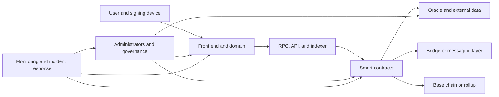
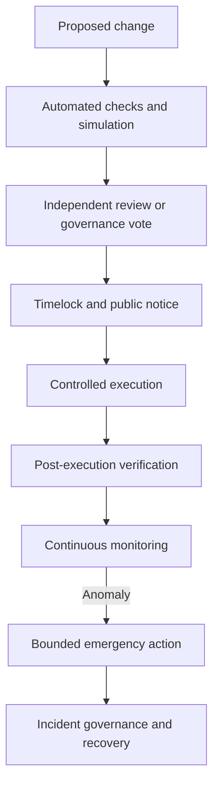
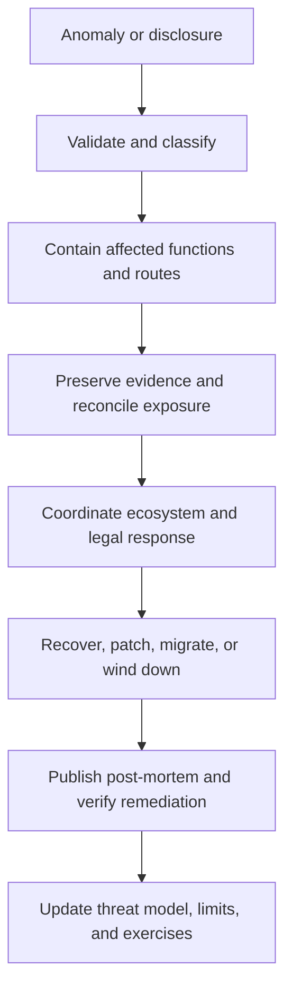

# Blockchain, Smart-Contract, and Operational Security

## Purpose and scope

Blockchain security is often reduced to smart-contract audits. That framing is too narrow. A technically correct contract can still lose assets because its oracle was manipulated, an administrator key was compromised, a bridge accepted a false message, a front end substituted an attacker address, or an operator misunderstood the system's economic exposure. Conversely, a deliberately upgradeable or centrally administered system is not automatically insecure. It has made a trust choice that must be visible, constrained, monitored, and governed.

The useful unit of analysis is therefore the complete value system: the economic promises made to users, the code that enforces them, the chain that orders transactions, the external data and cross-chain messages the code consumes, the keys and organizations that administer it, and the infrastructure through which users interact. Security means that this system continues to preserve defined properties despite mistakes, malicious actions, abnormal markets, and partial infrastructure failure.

This note develops that view from first principles. It covers public and permissioned networks, although many examples use Ethereum-style systems because their execution and failure patterns are well documented. It complements the narrower treatment of protocol economics in [DeFi Risk, Security, and Economic Attacks](../../04-decentralized-finance/04-defi-risk-and-failures/defi-risk-security-and-economic-attacks.md) and the custody treatment in [Wallets, Key Management, and Digital-Asset Custody](../../03-digital-assets-and-market-structure/04-wallets-and-custody/wallets-key-management-and-digital-asset-custody.md).

## 1. What is being secured?

### 1.1 Assets, authority, and promised properties

Security begins by stating what matters. A lending protocol may need to preserve depositor solvency, prevent unauthorized borrowing, calculate interest consistently, and remain liquid enough to process withdrawals. A tokenization platform may need to ensure that only eligible investors can transfer a security, that the onchain register remains synchronized with the legally authoritative register, and that no administrator can create unbacked units without an approved process. A custody system may prioritize preventing unauthorized signing while still allowing recovery after the loss of one key share.

These are not interchangeable goals. A control that maximizes one can weaken another. Requiring five people to approve every emergency action reduces unilateral misuse but may make a response too slow during an exploit. Removing every administrative function makes governance capture impossible, but also makes a discovered defect impossible to patch. Security design is the disciplined selection of properties and trade-offs, not the elimination of all trust or flexibility.

Three categories help organize the required properties:

- **Safety** means that something bad never happens. Assets cannot be created without authorization, a borrower cannot withdraw more than allowed, and one compromised key cannot upgrade the protocol.
- **Liveness** means that something good can eventually happen. A valid withdrawal can complete, governance can replace a failed service, and the network can continue finalizing transactions.
- **Correctness and integrity** mean that the system implements the intended rules. Balances conserve value, prices use the specified units, and a cross-chain action corresponds to an authenticated source-chain event.

Confidentiality is a fourth requirement for systems that handle identities, positions, bids, or commercial data. Public chains usually optimize for shared verification rather than confidentiality, so privacy requires additional cryptography, permissioning, or data-minimization measures.

### 1.2 Security is an end-to-end property

Consider a user who signs a transaction through a web application. The browser resolves a domain, downloads JavaScript, connects to a wallet, obtains data from an RPC endpoint, and asks the wallet to sign encoded calldata. A contract may then read a price from an oracle and send a message through a bridge. Every boundary can change the ultimate effect.



If the contract is audited but the deployment script points its proxy to the wrong implementation, the audited artifact is irrelevant. If the front end is compromised, it can induce valid signatures for malicious transactions without modifying the contract. If the oracle reports an incorrect price, flawless liquidation code will execute the wrong economic decision perfectly. This is why assurance must follow the transaction from human intent to final state.

### 1.3 Threat, vulnerability, exploit, and loss

These terms describe different stages of a causal chain. A **threat actor** has a motive and capability, such as stealing collateral, disrupting a service, or manipulating governance. A **vulnerability** is a weakness, such as an uninitialized proxy or a price based on one thin market. An **exploit** is the method used to turn the weakness into an unauthorized state transition. **Impact** is the resulting financial, operational, legal, or reputational harm.

Not every vulnerability is exploitable under current conditions, and not every exploit produces permanent loss. A monitoring system may detect the first malicious transaction, a pause guardian may contain the affected market, or validators may reject a message before settlement. Good analysis therefore follows the entire path rather than reporting a code defect without its preconditions and maximum plausible impact.

| Question | What it establishes | Example |
|---|---|---|
| What must remain true? | Security invariant | Total redeemable claims must not exceed controlled reserves |
| Who may try to violate it? | Threat actor and motive | External attacker, malicious signer, compromised vendor |
| What capability is required? | Exploit precondition | Flash liquidity, quorum control, leaked deployment key |
| Which boundary is crossed? | Attack surface | Oracle-to-contract or browser-to-wallet |
| How far can failure spread? | Blast radius | One isolated pool versus every asset behind a shared proxy |
| What limits or reverses harm? | Preventive and recovery control | Caps, delay, pause, insurance, migration |

## 2. Threat modeling a blockchain system

### 2.1 Start with flows, not components

A component inventory says that a system contains contracts, wallets, APIs, and an oracle. A threat model asks how value and authority move between them. The distinction matters because vulnerabilities often arise in composition. A lending contract and an automated market maker can each behave as designed while the lender's use of the AMM's instantaneous price permits manipulation.

A practical model traces four flows:

1. **Asset flows:** deposits, withdrawals, fees, collateral, minted claims, bridge lock-and-mint operations, and recovery transfers.
2. **Data flows:** prices, identities, proofs, signatures, block headers, reserve attestations, and offchain instructions.
3. **Authority flows:** deployment, upgrade, parameter change, pause, asset listing, oracle replacement, and key recovery.
4. **Failure flows:** which dependencies can make the system wrong, unavailable, insolvent, or uncontrollable.

The model should include both normal and abnormal paths. What happens if a price feed stops updating, a destination chain reorganizes, a signer is unavailable, gas becomes extremely expensive, a token starts charging a transfer fee, or every user attempts to withdraw at once? These are not exotic edge cases when the system holds market-sensitive value.

### 2.2 Trust assumptions are security dependencies

“Trustless” usually means that some trust has been replaced by verifiable computation and economic incentives. It rarely means the absence of trust. Users may still trust a validator threshold, an upgrade multisig, a data-provider committee, a sequencer, a legal custodian, or the issuer of a tokenized asset.

Each assumption should be written in falsifiable form. “The oracle is secure” is not useful. “At least 14 of 20 independent oracle nodes will report within the allowed deviation and heartbeat, and the underlying market remains costly to manipulate over the aggregation window” can be analyzed. “The bridge is decentralized” is vague. “An attacker cannot forge a destination message unless it controls 10 of 15 current validators or exploits the verification contract” reveals the actual threshold and software dependency.

### 2.3 Attacker economics

An exploit is attractive when expected benefit exceeds expected cost after accounting for failure probability, capital requirements, fees, slippage, detection, freezing, and legal exposure. Public blockchains reduce some operational friction: an attacker can borrow capital atomically, compose several venues, use private transaction delivery, and settle the strategy in one transaction. Atomicity does not create a vulnerability, but it lets attackers use temporary capital without bearing ordinary funding risk.

Suppose an oracle reads a thin pool. An attacker borrows 20 million units through a flash loan, trades enough to move the pool price, borrows 30 million of another asset against artificially valuable collateral, then unwinds the manipulation and repays the flash loan. The critical security question is not “Does the protocol allow flash loans?” It is “Can a temporary price movement create extractable credit larger than the full manipulation cost?”

| Threat-model layer | Core question | Typical output |
|---|---|---|
| Objectives | What value or property is protected? | Ranked assets and invariants |
| Architecture | Where do value, data, and authority flow? | Data-flow and trust-boundary diagram |
| Adversaries | Who has what capability and incentive? | Actor and capability matrix |
| Scenarios | How can an invariant be violated? | Misuse cases and attack trees |
| Controls | What prevents, detects, contains, and recovers? | Control mapping and residual risk |
| Validation | How is the claim tested? | Tests, simulations, reviews, and exercises |

## 3. Smart-contract state and execution risks

### 3.1 Smart contracts are adversarial state machines

A contract maps a prior state and a transaction into a new state. Its callers choose transaction inputs, transaction timing, call ordering, and often the contracts with which it interacts. In a composable environment, an external call may execute arbitrary code and re-enter the original system before its first operation has finished. Security therefore requires reasoning across sequences of calls, not merely checking each function in isolation.

An invariant is a property that must hold across all reachable states. Examples include:

- a vault's accounted assets equal controlled assets after permitted rounding and fees;
- no account can withdraw more than its balance;
- debt remains bounded by collateral under the defined price and risk parameters;
- only an authorized role can change implementation code;
- a cross-chain message identifier can be consumed at most once.

The difficult phrase is “all reachable states.” A unit test proves behavior for the cases written by the developer. Attackers search the cases the developer did not imagine: an empty market, the first depositor, a repeated callback, an unusual token, a stale price, a boundary timestamp, or a long sequence of individually valid actions.

### 3.2 Access control and confused authority

Access control failures occur when a caller can exercise authority it should not have. The most obvious form is a missing authorization check on a mint or upgrade function. More subtle forms include granting a role to the wrong address, allowing a role administrator to assign itself stronger roles, authenticating `tx.origin` instead of the immediate caller, or treating possession of a governance token as sufficient authority without resisting borrowed voting power.

Function visibility is not a complete authorization model. Marking a function `private` limits calls within Solidity code but does not protect a public administrative path that eventually invokes it. Effective control maps each sensitive operation to a role, defines who can grant and revoke that role, and limits the role's scope. An oracle manager need not also control withdrawals; a pause guardian need not be able to seize funds.

Administrative authority should normally sit behind a multisignature wallet or structured governance mechanism, but a multisig is only as strong as its signer independence and operating procedure. A five-of-seven wallet provides little protection if five keys are stored in one password manager or all signers approve an opaque transaction from the same compromised interface.

### 3.3 Reentrancy and unsafe external interaction

Reentrancy occurs when a contract makes an external call before completing its own state transition, and the recipient calls back into the original contract while it is in an intermediate state. The classic vulnerable sequence is:

```text
1. Read the caller's balance.
2. Send assets to the caller.
3. Reduce the recorded balance.
```

If step 2 transfers control to attacker code, the attacker can call the withdrawal function again before step 3. Both calls observe the old balance. The checks-effects-interactions pattern changes internal state before the external call; a reentrancy guard prevents nested entry into protected functions. Neither should be applied mechanically. Cross-function reentrancy can enter a different function that reads the same partially updated state, and read-only reentrancy can cause another protocol to observe a transient price or balance even when no second withdrawal occurs.

The deeper lesson is that every external call is a handoff of control. Token transfers can be external calls, especially with callback-enabled standards. A protocol must understand whether it can tolerate the callee executing arbitrary logic before control returns.

### 3.4 Arithmetic, precision, units, and rounding

Modern Solidity versions revert on ordinary integer overflow and underflow by default, but arithmetic remains a major source of financial error. Contracts represent fractions through scaled integers. One token may use 6 decimal places, another 18, and a price feed 8. Multiplying values before normalizing units can overstate collateral by orders of magnitude; dividing too early can discard material precision.

Rounding direction is an economic decision. When issuing vault shares, rounding in the user's favor can let repeated small deposits extract value from existing holders. When calculating required repayment, rounding down can leave residual bad debt. A safe design specifies who may receive the rounding benefit for every operation and tests the smallest, largest, and near-boundary amounts.

The “first depositor” vault attack illustrates how accounting and market mechanics combine. If an empty vault calculates shares from its current asset-to-share ratio, an attacker may deposit a small amount, donate assets directly to inflate the ratio, and cause the next depositor to receive zero or very few shares after rounding. Virtual shares, minimum initial liquidity, or carefully designed conversion rules can make the manipulation uneconomic.

### 3.5 Input validation and state transitions

Every public or external function accepts adversarial input. Validation covers more than numeric ranges. Addresses should not be zero where that would burn authority; arrays should have compatible lengths; deadlines should expire; signatures should bind the intended chain, contract, action, nonce, and parameters; and a lifecycle action should be legal in the current state.

A state-machine error might allow a loan to be finalized twice, a claim to be redeemed before vesting, or a cancelled order to execute because cancellation and fill use inconsistent identifiers. Explicit states and one-way transitions make these systems easier to reason about. A message should move from `unseen` to `processed`, never back to `unseen`; an initialized implementation should never be initializable again.

### 3.6 Denial of service and gas constraints

Liveness can fail even when no assets are stolen. A function that loops over an ever-growing list may eventually exceed the block gas limit. A “push” distribution that sends funds to every recipient may be blocked by one reverting recipient. An attacker may create many dust positions to make liquidation or settlement too expensive.

Pull-based claims, bounded iteration, pagination, and permissionless maintenance functions reduce these risks. Systems should also model fee spikes. A keeper operation that is profitable at ordinary gas prices may stop executing precisely when volatility makes liquidation most important.

### 3.7 Token integration hazards

An ERC-20-like interface does not guarantee uniform economic behavior. Tokens may charge transfer fees, rebase balances, blacklist addresses, pause transfers, return no Boolean value, invoke receiver hooks, or change behavior through an upgrade. A protocol that records the requested transfer amount instead of measuring the amount actually received can create unbacked internal credit.

Integration must define supported behavior rather than assume every token conforms to an idealized standard. Isolation and exposure caps limit the harm from a defective or malicious listed asset. Listing governance is consequently a security control, not merely a commercial decision.

| Contract risk | Why it occurs | Representative control | Residual question |
|---|---|---|---|
| Access-control failure | Authority check absent or role graph unsafe | Least privilege, multisig, role tests | Can role administrators escalate? |
| Reentrancy | External code runs during an incomplete transition | State update first, guard, pull pattern | Are shared-state and read-only paths covered? |
| Precision error | Integer units and rounding encode finance imperfectly | Unit conventions, boundary tests, conservative rounding | Who gains from every rounding direction? |
| Invalid lifecycle | Functions permit an impossible or repeated state | Explicit state machine, nonce, replay protection | Can concurrent paths disagree about state? |
| Denial of service | Work or dependency can be forced to fail | Bounded work, pull claims, fallback paths | Does recovery still work under high fees? |
| Token incompatibility | Integrated asset violates assumed semantics | Balance-delta accounting, allowlist, caps | Can the token upgrade after approval? |

## 4. Upgradeability, deployment, and administrative design

### 4.1 Immutability is a choice with consequences

Immutable code limits the ability of an administrator to alter rules after users commit capital. It also leaves no direct patch path. Upgradeability introduces a controlled way to replace logic while preserving state, but the upgrade authority becomes capable of changing almost any economic property. The relevant question is therefore not whether a protocol is “immutable” or “upgradeable”; it is whether its change model matches the value at risk and is accurately disclosed.

Proxy designs commonly keep state at a stable proxy address and execute code from a replaceable implementation using `delegatecall`. Because the implementation writes into the proxy's storage, layout compatibility is critical. Reordering variables or changing inherited storage incorrectly can reinterpret balances as addresses or overwrite administrative slots. Standardized storage slots, upgrade-aware libraries, layout checks, and staged testing reduce this risk.

### 4.2 Initialization and deployment

Proxy implementations do not use constructors in the ordinary way. They use an initializer that must execute once in the proxy's storage context. If the initializer remains publicly callable, an attacker may become owner. An implementation contract may also need to be locked against initialization so it cannot be taken over and used in an unexpected path.

Deployment is part of the trusted codebase. Teams should reproduce compiler settings, verify bytecode, record constructor or initializer arguments, check network and address values, and transfer temporary deployment authority to the intended governance system. A technically secure source repository does not compensate for deploying a different artifact.

### 4.3 Delays, guardians, and bounded authority

A timelock publishes a queued administrative action and delays execution. It gives users and monitors time to inspect an upgrade or parameter change. A delay does not help if the description is opaque, the action can bypass the queue, or users cannot exit during the interval. Emergency guardians create the opposite trade-off: they can act quickly, but their power should generally be narrower than ordinary governance—such as pausing new borrowing without transferring user assets.

Mature administration separates routine parameter updates, emergency containment, and structural upgrades. Each class receives a suitable approval threshold, delay, monitoring rule, and maximum scope.



| Administrative choice | Security benefit | Security cost | Useful constraint |
|---|---|---|---|
| Immutable contract | Eliminates upgrade-key risk | Defects may be permanent | Small, well-specified scope and migration path |
| Single administrator | Fast and simple | One key or insider controls system | Generally unsuitable for high-value authority |
| Multisig | Requires several approvals | Collusion and common-mode compromise remain | Independent signers, hardware separation, rehearsals |
| Token governance | Broad participation and transparency | Delegation concentration, apathy, vote borrowing | Quorum, delay, proposal threshold, scoped execution |
| Timelock | Creates inspection and exit window | Slows urgent response | Separate emergency powers with lower scope |
| Pause guardian | Contains active incident | Can censor or freeze activity | Limited functions, expiration, monitored use |

## 5. Oracles, markets, and economic security

### 5.1 Code cannot validate an external fact by itself

A blockchain can reach consensus on what an oracle contract reported. It cannot natively determine whether that report reflects the external world. Oracle security is therefore the security of data origin, aggregation, transmission, update conditions, and consumption.

A robust price is not simply an average of many numbers. Ten feeds derived from the same exchange share a common dependency. A median rejects outliers only if enough independent observations remain honest. A time-weighted price resists brief manipulation but reacts slowly to a real market break. Every design trades responsiveness against manipulation resistance.

The consuming protocol must check freshness, units, sign, confidence, and deviation. If the feed stops, “use the last price forever” can permit borrowing against obsolete collateral. “Immediately liquidate everything” can be equally destructive. A safer response may freeze new risk, use a bounded fallback, permit repayments, and require governance to restore normal operation.

### 5.2 Manipulation versus genuine dislocation

Oracle attacks often exploit a feedback loop between market depth and protocol credit. The attacker moves a reference market, the protocol treats the move as fundamental value, and the resulting loan or redemption finances the attack. Controls include using deeper external markets, aggregating venues, applying time windows, capping how much credit a newly listed asset can generate, and bounding price changes.

However, a genuine crash can resemble manipulation. A conservative circuit breaker may prevent bad borrowing but also delay liquidations and increase lender losses. Risk teams should simulate both false prices and true rapid repricing rather than optimize only for one.

### 5.3 Liquidations and incentives

Liquidation mechanisms depend on third parties acting when collateral becomes insufficient. They need sufficient reward to cover gas, slippage, and inventory risk, but an excessive bonus punishes borrowers and can accelerate cascades. Thin liquidity, congested chains, or failing keeper infrastructure may leave positions unliquidated.

A protocol should model the entire liquidation route: oracle update, transaction delivery, collateral seizure, asset sale, and debt repayment. The quoted collateral ratio is not equivalent to recoverable value if selling the collateral moves the market sharply.

### 5.4 Governance and incentive attacks

Governance controls economic code. An attacker may acquire or borrow voting power, pass a malicious proposal, and execute it through legitimate machinery. Snapshotting voting power before proposal creation, requiring proposal bonds, delaying execution, and restricting callable actions can raise the cost. Social vetoes or security councils add an explicit trust layer that may be justified for catastrophic proposals, but their authority must be transparent.

Token incentives can also create slow failure. Emissions may attract liquidity that disappears when rewards fall. A stablecoin may appear overcollateralized at posted prices while its collateral is endogenous and becomes illiquid during stress. Security review must test equilibrium behavior after subsidies, during correlated declines, and when rational participants all attempt the same exit.

| Economic dependency | Failure question | Worked example | Typical mitigation |
|---|---|---|---|
| Price oracle | Can reported value be moved more cheaply than credit extracted? | Thin token pool is moved for one block, enabling excess borrowing | Multiple deep sources, time window, caps |
| Liquidation | Can collateral be sold before debt exceeds recovery value? | Gas spike and thin liquidity strand unhealthy loans | Incentive calibration, backstop, partial liquidation |
| Governance | Can temporary voting power authorize permanent extraction? | Borrowed tokens vote for an upgrade that transfers reserves | Snapshot, delay, quorum, execution scope |
| Incentives | Does the system remain solvent after rewards disappear? | Mercenary liquidity exits together when emissions fall | Stress testing, durable fee economics |
| Composability | Can another protocol place this system in an unmodeled state? | Callback observes transient pool balances as a valid price | Integration-specific invariants and circuit breakers |

## 6. Cross-chain and bridge security

### 6.1 A bridge creates a new verification system

A source chain and destination chain do not automatically share state. A bridge must convince a destination contract that an event occurred and became sufficiently final on the source. It may use light-client proofs, a validator or guardian committee, an optimistic challenge period, zero-knowledge proofs, or an external messaging network. The security of the transferred asset becomes the security of that verification path plus both chains.

In a lock-and-mint bridge, original assets are locked on chain A and representations are minted on chain B. If false messages mint unbacked representations, an attacker can sell them for genuine assets on chain B while the locked collateral remains unchanged. The bridge's accounting has become insolvent even though neither base chain failed.

### 6.2 Finality, replay, and domain separation

Accepting a source event too early exposes the destination to a source-chain reorganization. Waiting longer reduces reorganization risk but delays transfers. The correct threshold depends on the source chain's consensus, economic value, and failure assumptions.

Every message must be bound to a source chain, destination chain, sending application, receiving application, nonce, and payload. Without domain separation, a valid signature or proof intended for one chain or application may be replayed elsewhere. Message consumption must be idempotent: retries should not create a second transfer.

### 6.3 Shared infrastructure and blast radius

Generic bridges connect many applications and assets, creating concentration. A defect in a shared verification contract or compromised validator set may expose all connected pools. Rate limits, per-asset caps, per-route limits, delayed large transfers, independent anomaly detection, and isolated upgrade domains can reduce maximum loss.

Application teams cannot outsource the entire risk to the bridge. They decide which routes to trust, what limits to apply, how to respond when messaging stops, and whether a remote governance message may invoke privileged local functions.

For a deeper comparison of verification designs, see [Blockchain Interoperability and Bridges](../../06-interoperability-privacy-and-enterprise-dlt/01-interoperability/blockchain-interoperability-and-bridges.md).

| Bridge model | Principal trust assumption | Typical advantage | Principal risk |
|---|---|---|---|
| Native or light-client verification | Destination correctly verifies source consensus | Strong protocol-level verification | Complex, chain-specific, costly updates |
| External validator committee | Threshold of signers remains honest and available | Broad connectivity and simpler verification | Key compromise or validator collusion |
| Optimistic verification | Invalid messages can be challenged during a window | Lower verification cost | Watcher failure and delayed finality |
| Proof-based verification | Proof system and verified source state are correct | Succinct verification | Circuit, implementation, or setup defects |
| Liquidity network | Liquidity providers honor transfers and rebalance | Fast user experience | Liquidity, counterparty, and routing limits |

## 7. Chain, consensus, and rollup dependencies

### 7.1 Base-chain risks

Smart contracts inherit the ordering, finality, and availability of their chain. Consensus attacks can censor transactions, reorganize recent history, or halt finality. The practical threshold and consequence vary by mechanism. Proof-of-stake systems add concerns such as validator concentration, correlated client defects, slashing, and social recovery after catastrophic consensus failure.

Applications should distinguish probabilistic inclusion from economic or deterministic finality. A deposit credited after one block may later disappear in a reorganization. High-value cross-chain or offchain settlement should use confirmation rules proportional to chain risk rather than a universal block count.

### 7.2 Mempools, ordering, and MEV

Pending public transactions reveal intent. Searchers can reorder, insert, or surround transactions when the resulting ordering is profitable. A sandwich attack buys before a victim's trade, lets the victim move the price, and sells afterward. The victim authorized the trade, but the execution quality was adversarially degraded.

Slippage limits and short deadlines prevent execution outside the user's bounds; batch auctions, frequent clearing, commit-reveal mechanisms, and private order flow alter information and ordering. Private delivery reduces public leakage but introduces reliance on builders, relays, or other intermediaries. Protocols should state whether ordering is a normal market mechanism, a fairness concern, or a solvency dependency.

### 7.3 Rollups and sequencers

A rollup inherits some security from its settlement chain but introduces its own components. A centralized sequencer may censor or delay transactions. Data availability failure may prevent users from reconstructing state. Fraud-proof or validity-proof systems depend on their proof machinery and upgrade controls. A bridge from the settlement chain into the rollup may have delayed withdrawals or emergency modes.

The key user question is the escape path: if the sequencer and ordinary interface disappear, can a user force a transaction, prove ownership, and withdraw using available data? A documented mechanism that is too complex, costly, or centrally gated to use during crisis provides weaker practical protection than its theoretical description suggests.

| Chain layer | Dependency inherited by application | Design response |
|---|---|---|
| Consensus | Transaction inclusion, ordering, reorganization, finality | Confirmation policy, chain diversification where justified |
| Execution client | Correct state transition | Client diversity, monitored network health |
| Mempool and builder market | Information leakage and ordering | Slippage, private routing, batch or intent design |
| Rollup sequencer | Timely inclusion and ordering | Forced inclusion and contingency procedure |
| Data availability | Ability to reconstruct and prove state | Availability guarantees and user escape testing |
| Proof and bridge system | Correct settlement of rollup state | Upgrade review, challenge/proof monitoring |

## 8. Keys, wallets, custody, and transaction authorization

### 8.1 Protecting a key is not the same as controlling intent

A private key proves that a valid signer authorized bytes. It does not prove that the signer understood those bytes or that the transaction reflected organizational policy. Many losses occur when secure hardware signs the wrong transaction after a compromised application, deceptive simulation, or flawed approval process.

A complete authorization control has three layers:

1. **Key protection** prevents extraction or unauthorized use of signing material.
2. **Policy enforcement** checks asset, destination, amount, contract, function, time, and required approvers.
3. **Intent verification** presents a human-readable explanation derived independently from the transaction and confirms that it matches the business instruction.

A hardware security module can satisfy the first while a policy engine and operational process fail the latter two.

### 8.2 Key lifecycle

Key generation should use approved entropy and devices, with evidence that plaintext material was never exposed. Backup and recovery must be tested; an untested backup is a hypothesis. Rotation, revocation, and destruction procedures matter when personnel or roles change. Address allowlists, velocity limits, withdrawal delays, and destination screening constrain the effect of a compromised key.

Multisignature contracts and multi-party computation distribute control differently. In an onchain multisig, several distinct keys produce approvals that the contract verifies. In threshold MPC, parties jointly produce one ordinary signature without reconstructing the complete key. Both reduce single-key risk, but neither guarantees organizational independence. Common software, cloud, identity provider, or approval channels can create a shared point of compromise.

### 8.3 Transaction simulation and blind signing

Modern contracts encode calls as opaque hexadecimal data. Blind signing asks a person to approve without reliably understanding the effect. Simulation executes the proposed transaction against a recent state and reports expected balance and permission changes. It can reveal that a “claim” grants unlimited token approval or transfers a valuable asset.

Simulation is not infallible. State may change before inclusion, a contract may behave differently based on sender or block conditions, and upgradeable code may change. High-value workflows combine simulation with allowlisted code hashes or contracts, independent decoding, change detection, and out-of-band confirmation.

### 8.4 Recovery and continuity

Preventing unauthorized access while guaranteeing eventual recovery is a central custody tension. A two-of-three scheme tolerates one lost signer, but its recovery process may itself become the easiest attack path. Recovery shares should be geographically and organizationally separated, and invoking recovery should trigger stronger monitoring and delayed activation.

| Custody control | What it protects | What it does not prove |
|---|---|---|
| HSM or secure enclave | Key material resists extraction | Transaction is economically intended |
| Multisig or threshold MPC | One compromised share is insufficient | Signers are independent or attentive |
| Policy engine | Transaction fits configured limits | Configuration is correct and current |
| Allowlist and delay | Limits destination and response window | Allowed destination is uncompromised |
| Simulation | Predicts likely onchain effects | State and implementation cannot change |
| Backup and recovery | Preserves access after loss | Recovery path cannot be socially engineered |

## 9. Offchain infrastructure and software supply chains

### 9.1 The decentralized back end may have a centralized doorway

Users frequently depend on one domain, web bundle, RPC provider, indexer, and hosted API. Compromising the domain-name registrar or deployment pipeline can replace the interface while leaving contracts unchanged. A malicious front end can substitute an attacker address, request an unlimited approval, or hide the true call.

Defenses include hardware-protected registrar accounts, multi-person deployment approval, content security policy, reproducible builds, signed releases, subresource integrity where applicable, independent transaction decoding, and multiple published access paths. The contract address should be discoverable through authenticated channels so users can distinguish protocol state from a compromised interface.

### 9.2 RPC, indexers, and stale state

RPC providers translate application queries into chain data. A faulty or malicious endpoint can hide transactions, provide stale balances, or misrepresent gas estimates, even though it cannot forge a valid block accepted by the wallet's own verifier. Most wallets and applications do not independently verify every response, so provider diversity and consistency checks matter for high-value operations.

Indexers derive convenient application state from raw events and calls. They can be temporarily inconsistent during reorganizations or miss events after an outage. Financial reconciliation should compare derived balances with authoritative onchain state and handle reprocessing idempotently.

### 9.3 Dependencies, build systems, and deployment secrets

Smart-contract projects import packages, compiler versions, scripts, container images, and continuous-integration actions. A compromised dependency can alter deployment artifacts or steal signing credentials. Pinning versions and hashes, reviewing dependency changes, generating a software bill of materials, isolating build credentials, and reproducing bytecode reduce the risk.

The deployment environment should not hold broad production keys by default. Short-lived credentials, protected branches, reviewed release tags, separation between build and sign, and an auditable promotion path make it harder for a repository compromise to become an onchain upgrade.

### 9.4 Availability and conventional cyber risk

Phishing, credential theft, ransomware, insider abuse, cloud misconfiguration, and denial-of-service remain relevant. Blockchain does not remove ordinary security engineering; it often raises the consequence because transactions are rapid and difficult to reverse. NIST's Cybersecurity Framework and Secure Software Development Framework provide useful organizational structures even though they are not blockchain-specific.

| Offchain layer | Failure effect | Control themes |
|---|---|---|
| Domain and front end | Users sign malicious but valid transactions | Registrar hardening, signed builds, simulation |
| RPC provider | Stale or misleading view; failed submission | Multiple providers, consistency checks |
| Indexer | Incorrect positions or history | Reorg handling, replay, onchain reconciliation |
| CI/CD pipeline | Malicious artifact or leaked deployment authority | Isolated signing, pinned dependencies, provenance |
| Cloud and identity | Service outage or administrator takeover | Least privilege, strong authentication, recovery |
| Communication channel | False incident or migration instructions | Authenticated channels and predeclared procedures |

## 10. Secure development and assurance

### 10.1 Specification before implementation

Security tools cannot determine whether code implements an unstated economic intention. A specification should describe actors, states, permissions, accounting identities, failure behavior, and invariants. For a lending pool, “interest accrues correctly” is too vague. The specification should define the index, elapsed-time convention, rounding, fee allocation, behavior at zero utilization, and bounds under extreme time gaps.

Executable properties turn this reasoning into tests. “The sum of individual shares equals total shares,” “a successful withdrawal cannot increase user shares,” and “an unauthorized address can never change the oracle” are examples that fuzzers or formal tools can attempt to violate.

### 10.2 Complementary test methods

Unit tests validate known examples and normal behavior. Integration tests exercise contracts together and against realistic token and oracle behavior. Differential tests compare two implementations of the same rule. Fuzzing generates many inputs or action sequences to find invariant violations. Static analysis examines code without executing it, identifying patterns and data flows. Symbolic execution explores paths using symbolic inputs. Formal verification proves that a model satisfies a specification under stated assumptions.

No method dominates. A proof of the wrong specification provides false confidence; a fuzzer may not reach a very deep state; static tools trade false positives against missed patterns; an audit is bounded by scope, time, code version, and assumptions. Assurance comes from independent, overlapping methods and explicit coverage.

### 10.3 Review, audit, and remediation

An audit is a structured independent review, not a certificate that a system is safe. Its report should identify the exact commit, dependencies, deployment configuration, out-of-scope components, threat assumptions, and unresolved findings. Material changes after audit may invalidate its conclusions.

Finding severity should combine exploitability and impact, not merely code pattern. Remediation needs verification, and accepted risks need a named owner and compensating control. Publishing reports improves transparency, but users should check whether critical findings were fixed and whether the deployed bytecode corresponds to the reviewed code.

### 10.4 Bug bounties and responsible disclosure

After deployment, external researchers expand the review population. A bounty should define eligible assets and contracts, severity rules, maximum rewards, safe-harbor terms, disclosure channel, response timeline, and treatment of dependent protocols. Reward size should be credible relative to value at risk and exploit opportunity, although no bounty can guarantee ethical behavior.

### 10.5 Security gates across the lifecycle


| Assurance method | Best at answering | Important limitation |
|---|---|---|
| Unit and integration tests | Do specified examples and components work? | Only covers cases and assertions written |
| Static analysis | Does code contain suspicious patterns or flows? | Pattern findings need context; novel logic may escape |
| Fuzzing and invariant tests | Can generated sequences violate a property? | Reachability and property quality limit results |
| Formal verification | Does the model satisfy a precise property? | Assumptions, model, and specification can be incomplete |
| Economic simulation | Is the system robust to prices, liquidity, and incentives? | Model behavior may differ from live participants |
| Independent audit | What did skilled reviewers find in a defined scope? | Time-bound snapshot, not a guarantee |
| Bug bounty | What can a broad external population find after launch? | Reactive and dependent on incentives and disclosure |

## 11. Monitoring, containment, and incident response

### 11.1 Monitoring should follow invariants

Volume dashboards are not security monitoring. Alerts should identify conditions connected to loss: unexpected minting, changes to privileged roles, upgrades, oracle staleness or deviation, reserve imbalance, unusual approvals, rapid borrowing, bridge outflows, governance proposals, and failures of keeper actions.

Thresholds alone are insufficient. A legitimate market event can exceed a static threshold, while a patient attacker stays just below it. Useful monitoring combines rules, behavioral baselines, graph relationships, simulation, and human escalation. Every critical alert should have an owner and a tested response; an unowned alert merely documents failure in real time.

### 11.2 Containment is designed before the incident

Controls such as asset caps, withdrawal rate limits, isolated markets, pausing, delayed upgrades, and circuit breakers define the blast radius. They are most effective when present before deployment. During an active exploit, introducing a new emergency mechanism is slow, risky, and politically contested.

Pausing needs granularity. Stopping new deposits or borrowing may contain growth while still allowing repayments. Freezing all withdrawals protects pooled assets but traps unaffected users and may create legal and confidence consequences. The incident authority should know which operations each pause mode affects.

### 11.3 Response phases

The first objective is to establish facts without delaying containment. Teams preserve logs, identify affected contracts and chains, verify whether suspicious activity continues, and activate a preapproved decision structure. Communications should distinguish confirmed facts from hypotheses and use authenticated channels.

After containment, teams trace funds, coordinate with exchanges, stablecoin issuers, validators, law enforcement, auditors, and dependent protocols as appropriate. Recovery may include patching, migration, negotiated return, claims administration, recapitalization, or insolvency. A post-incident review should explain technical root cause, contributing governance and operational conditions, detection and response timing, financial reconciliation, and durable remediation.



### 11.4 Recovery is a financial process too

Technical remediation does not determine who absorbs loss. A protocol may have treasury assets, insurance, a safety module, recoverable collateral, claims against service providers, or governance-approved recapitalization. The order in which these resources absorb loss is a loss waterfall. It should be understood before an incident where possible.

A restored contract is not a reconciled balance sheet. Operators must calculate affected assets, liabilities, duplicate or failed transactions, legal claims, and any difference between onchain and offchain records. Recovery therefore joins security engineering, finance, operations, legal analysis, and communication.

| Response capability | Question to answer before launch |
|---|---|
| Detection | Which invariant violations trigger a page, and who receives it? |
| Authority | Who may pause, upgrade, communicate, and engage counterparties? |
| Scope | Can one asset or route be isolated without stopping the whole system? |
| Evidence | Are logs, traces, build artifacts, and approvals preserved? |
| Reconciliation | Can assets and liabilities be calculated at an incident block? |
| Communication | Which authenticated channels and approval process are used? |
| Recovery | Is migration, compensation, or wind-down technically and financially possible? |

## 12. Security for institutions and permissioned systems

### 12.1 Control evidence matters

An institution needs more than a claim that a protocol is decentralized or audited. It needs evidence tying controls to its own exposure: architecture and data flows, privileged roles, code provenance, audit scope, key-management design, business continuity, incident notification, subcontractors, legal allocation of responsibility, and financial resources.

Permissioned networks replace some anonymous-adversary problems with consortium-governance and identity problems. Who admits participants, rotates certificates, changes shared code, resolves inconsistent states, and acts when an operator fails? Consensus among known entities does not remove cyber compromise, collusion, software defects, or legal disagreement.

### 12.2 Third-party and concentration risk

Several services may appear independent while sharing one cloud provider, RPC platform, identity provider, code library, oracle source, or custody technology. Mapping fourth-party dependencies reveals common-mode failure. Exit plans should cover data export, key transfer or rotation, replacement of endpoints, contract migration, and continuity during supplier distress.

### 12.3 Segregation of duties

The person who proposes a production change should not unilaterally build, approve, sign, and verify it. Operational segregation can exist even when an onchain multisig is the final authority. Separate teams validate business instruction, technical calldata, risk limits, and signing policy. Emergency processes may compress these steps, but should not make one unreviewed credential omnipotent.

| Institutional domain | Evidence to seek | Common weak interpretation |
|---|---|---|
| Architecture | Complete dependencies and trust boundaries | “Runs on blockchain” |
| Code assurance | Commit-specific reviews, tests, deployment match | “Audited” without scope or version |
| Key governance | Generation, policy, quorum, recovery, exercises | “Uses MPC” as a complete answer |
| Resilience | Recovery objectives, alternate providers, tested exits | Generic cloud continuity statement |
| Financial protection | Limits, segregation, reserves, loss waterfall | Marketing use of “insured” |
| Incident management | Notification, authority, evidence, reconciliation | Security policy without protocol-specific playbook |
| Change governance | Approval, delay, simulation, rollback or migration | Informal administrator discretion |

## 13. Worked system example: securing an onchain lending market

Assume a market accepts Token C as collateral and lends Stablecoin S. The contract code enforces a 70 percent maximum loan-to-value ratio and liquidation begins at 80 percent. A superficial review might check that the formula is implemented correctly. An end-to-end review asks what makes the posted value of C reliable and whether S can actually be recovered.

The oracle aggregates C prices from two exchanges. Both exchanges derive most liquidity from the same automated market maker, so the sources are not economically independent. The protocol should estimate how much capital is required to move the price over the oracle window and compare it with maximum borrowable S. A supply cap on C and borrow cap on S ensure that even a successful manipulation cannot drain the entire pool.

Liquidators need to sell C for S. During a genuine crash, market depth falls while gas and competition rise. Simulation should apply correlated price and liquidity shocks, not just a price decline against normal depth. Partial liquidations may avoid dumping an entire position, while a reserve or backstop can absorb residual debt.

The market is governed by a multisig that can change the oracle and caps. Its signers use hardware devices, but all obtain proposed calldata from one operations dashboard. Independent decoding and simulation are required so compromise of that dashboard cannot trick the quorum. Cap increases pass through a delay; an emergency guardian can freeze new borrowing immediately but cannot transfer collateral.

Monitoring tracks oracle freshness and cross-source divergence, utilization, concentration, liquidation failures, privileged actions, and rapid same-block deposit-and-borrow sequences. The response playbook can freeze new borrowing, preserve repayments, replace the oracle after approval, and reconcile pool assets and claims at a chosen block.

This example shows why “the contracts were audited” answers only one part of the security question. Solvency emerges from code, markets, incentives, authority, infrastructure, and response capacity together.

## 14. A reusable assessment sequence

A rigorous review can proceed in the following order:

1. Explain the economic service and identify every asset, claim, and liability.
2. Define safety, liveness, integrity, and confidentiality properties in plain language.
3. Draw asset, data, authority, and failure flows across onchain and offchain components.
4. State trust assumptions and quantify thresholds, delays, caps, and finality where possible.
5. Model external, insider, governance, supply-chain, and dependency threats.
6. Translate important properties into invariants, abuse cases, tests, and monitoring rules.
7. Review code, deployment, upgrades, oracles, token behavior, bridges, keys, and infrastructure as one system.
8. Calculate maximum exposure and blast radius under plausible combinations of failure.
9. Verify preventive, detective, containment, recovery, and financial-loss-allocation controls.
10. Repeat after material code, parameter, dependency, market, or governance change.

The sequence matters because tools should validate an understood system. Running a scanner before defining the system's promises finds patterns, not necessarily its most important risks.

## 15. Key takeaways

Blockchain security is the preservation of defined economic and technical properties across an adversarial, composable system. Smart-contract correctness is necessary but insufficient. Oracles determine what external facts the code believes; bridges determine which remote events it accepts; chains determine ordering and finality; keys determine who can exercise authority; and offchain infrastructure shapes what users see and sign.

The strongest approach begins with assets, flows, trust boundaries, and invariants. It layers specification, simple design, tests, program analysis, independent review, constrained deployment, continuous monitoring, and rehearsed recovery. Every control has a failure mode: multisigs can share dependencies, timelocks can delay rescue, pauses can trap users, and formal proofs can validate incomplete specifications.

Finally, security must be financially literate. It asks not only whether code can be exploited, but how much value can be extracted, whether markets remain liquid under stress, which claims become impaired, and who bears loss. That end-to-end view turns a vulnerability checklist into a usable security discipline.

## Related notes

- [Cryptography and Blockchain Data Structures](../../02-blockchain-foundations/01-core-architecture/cryptography-and-blockchain-data-structures.md)
- [Smart Contracts, Virtual Machines, and Token Standards](../../02-blockchain-foundations/03-execution-and-applications/smart-contracts-virtual-machines-and-token-standards.md)
- [Oracles, Indexers, and Offchain Data](../../02-blockchain-foundations/03-execution-and-applications/oracles-indexers-and-offchain-data.md)
- [Wallets, Key Management, and Digital-Asset Custody](../../03-digital-assets-and-market-structure/04-wallets-and-custody/wallets-key-management-and-digital-asset-custody.md)
- [Blockchain Interoperability and Bridges](../../06-interoperability-privacy-and-enterprise-dlt/01-interoperability/blockchain-interoperability-and-bridges.md)
- [DeFi Risk, Security, and Economic Attacks](../../04-decentralized-finance/04-defi-risk-and-failures/defi-risk-security-and-economic-attacks.md)
- [Digital-Asset Failures and Lessons](digital-asset-failures-and-lessons.md)

## References

- Ethereum.org, [Smart contract security](https://ethereum.org/developers/docs/smart-contracts/security/)
- Solidity documentation, [Security considerations](https://docs.soliditylang.org/en/latest/security-considerations.html)
- OpenZeppelin, [Contracts documentation](https://docs.openzeppelin.com/contracts/)
- OpenZeppelin, [Upgrades documentation](https://docs.openzeppelin.com/upgrades-plugins/)
- Trail of Bits, [Building Secure Contracts](https://secure-contracts.com/)
- Trail of Bits, [A guide to smart contract security tools](https://ethereum.org/developers/tutorials/guide-to-smart-contract-security-tools/)
- OWASP, [Smart Contract Top 10](https://owasp.org/www-project-smart-contract-top-10/)
- OWASP, [Smart Contract Security Verification Standard](https://scs.owasp.org/)
- Smart Contract Weakness Classification Registry, [SWC Registry](https://swcregistry.io/)
- Ethereum Improvement Proposals, [EIP-712: Typed structured data hashing and signing](https://eips.ethereum.org/EIPS/eip-712)
- Ethereum Improvement Proposals, [EIP-1967: Proxy storage slots](https://eips.ethereum.org/EIPS/eip-1967)
- Ethereum Improvement Proposals, [EIP-4626: Tokenized vault standard](https://eips.ethereum.org/EIPS/eip-4626)
- Chainlink documentation, [Price Feeds](https://docs.chain.link/data-feeds/price-feeds)
- Ethereum.org, [Maximal extractable value](https://ethereum.org/developers/docs/mev/)
- Ethereum.org, [Formal verification of smart contracts](https://ethereum.org/developers/docs/smart-contracts/formal-verification/)
- NIST, [Cybersecurity Framework 2.0](https://www.nist.gov/cyberframework)
- NIST, [Secure Software Development Framework, SP 800-218](https://csrc.nist.gov/pubs/sp/800/218/final)
- NIST, [Key Management Guidelines, SP 800-57 Part 1](https://csrc.nist.gov/pubs/sp/800/57/pt1/r5/final)
- Cloud Security Alliance, [Blockchain and Distributed Ledger Technology](https://cloudsecurityalliance.org/research/working-groups/blockchain)
- Basel Committee on Banking Supervision, [Principles for operational resilience](https://www.bis.org/bcbs/publ/d516.htm)
- CPMI-IOSCO, [Guidance on cyber resilience for financial market infrastructures](https://www.bis.org/cpmi/publ/d146.htm)
