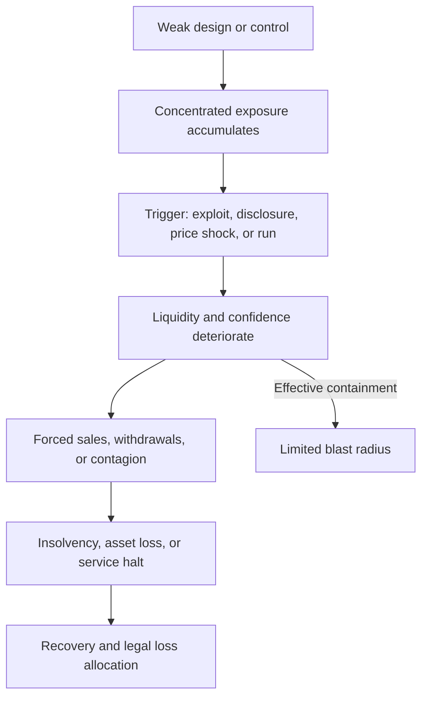
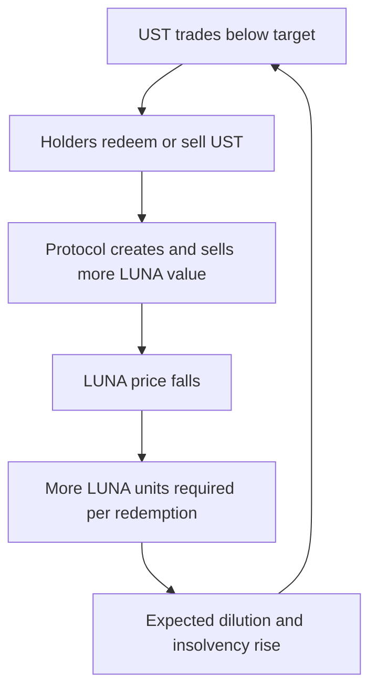
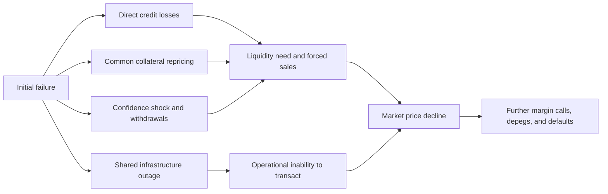

# Digital-Asset Failures and Lessons

## Purpose and method

Digital-asset failures are often narrated as isolated hacks or as evidence for a single sweeping conclusion about blockchain. Neither approach teaches much. A smart-contract defect, a compromised signing workflow, an insolvent lender, a fraudulent exchange, an unstable token design, and a consensus failure have different causes and require different controls. Some events make an onchain system behave contrary to its specification. Others make it execute a flawed specification exactly. Still others occur almost entirely in an offchain company that happens to hold crypto-assets.

This note studies representative failures as systems. Each case asks:

1. What service and promise did users believe they were receiving?
2. Which assets, liabilities, privileges, and dependencies actually existed?
3. What initiating event exposed the weakness?
4. Which technical, economic, governance, and operational conditions allowed harm to grow?
5. How was the event detected, contained, recovered, and allocated financially?
6. Which lesson generalizes, and which details are specific to the case?

Loss values are approximate unless a court, regulator, bankruptcy examiner, or official post-mortem establishes a precise amount. Crypto-asset prices move during incidents, recovered funds may later reduce net loss, and a protocol's recorded exposure is not always the same as the final creditor shortfall. The goal is causal understanding, not a leaderboard.

## 1. A vocabulary for failure

### 1.1 Failure, exploit, fraud, insolvency, and run

A **technical exploit** uses a defect or unsafe assumption to produce an unintended state transition. Reentrancy that drains a contract is an exploit. A **key compromise** uses valid credentials without valid organizational intent. The transaction is cryptographically authentic but operationally unauthorized.

An **economic-design failure** occurs when all code and transactions can be valid while the system's incentives or balance-sheet structure become unstable. An algorithmic stablecoin whose redemption mechanism creates a reflexive death spiral is the clearest example. **Fraud or governance abuse** involves people concealing, misrepresenting, or misusing authority and assets. **Insolvency** means the realizable value of assets is insufficient to meet liabilities; **illiquidity** means obligations cannot be met when due even if long-term asset value might be adequate. A **run** is the feedback process in which holders rush to exit because they expect others to exit, forcing asset sales and validating the original fear.

These categories can coexist. A lender may begin with poor risk management, become insolvent after market losses, conceal the shortfall, and then fail during a withdrawal run. An exchange may have strong wallet cryptography but weak accounting and governance. A bridge exploit may begin with social engineering, obtain validator keys, and use legitimate protocol messages to create unauthorized withdrawals.

### 1.2 Root cause versus trigger

The trigger is the event that makes failure visible. The root cause is the condition that made the trigger destructive. A token price decline may trigger margin calls, but excessive leverage and illiquid collateral created the vulnerability. A phishing message may trigger a malicious signature, but an approval process that trusted one compromised front end allowed the loss.

Good post-mortems distinguish at least four layers:

- **Root cause:** the fundamental design, control, or integrity failure.
- **Contributing conditions:** concentration, complexity, poor monitoring, weak segregation, or market stress that amplified it.
- **Trigger:** the transaction, disclosure, price move, or withdrawal surge that exposed it.
- **Impact path:** how the initial weakness propagated into asset loss, insolvency, service failure, or contagion.

### 1.3 Gross loss, net loss, and creditor outcome

Headlines usually report the market value transferred during an exploit. That is gross outflow, not necessarily final economic loss. Funds may be frozen, returned, recovered through legal process, or offset by capital. Conversely, market disruption and secondary insolvencies may make total harm larger than the initial outflow.

Creditor recovery also depends on legal structure and time. Customers may own segregated assets, have a contractual claim against an estate, or rank with unsecured creditors. A bankruptcy can take years, during which the relevant asset appreciates or depreciates. The difference between a technical balance and a legally enforceable claim is therefore central.

| Failure type | Primary mechanism | What can still appear valid? | Main control family |
|---|---|---|---|
| Contract exploit | Code or state-machine weakness | Attacker transactions satisfy network rules | Specification, testing, audit, limits |
| Key or interface compromise | Valid signature generated under false intent | Signature and admin transaction | Independent intent verification, key policy |
| Economic-design failure | Incentives and balance sheet become unstable | Code, prices, and redemptions | Stress testing, reserve quality, circuit breakers |
| Fraud or governance abuse | Authorized people misuse or conceal authority | Internal approvals and records may be manipulated | Segregation, custody, audit, governance |
| Liquidity or credit failure | Maturity, collateral, and leverage mismatch | Assets may have stated marks | Liquidity buffers, concentration limits |
| Consensus or infrastructure failure | Chain, sequencer, RPC, cloud, or client fails | Contracts may be unchanged | Diversity, failover, escape paths |

## 2. Recurring causal patterns

### 2.1 Hidden leverage and reflexivity

Leverage turns a price decline into forced selling. Reflexivity makes the sale reduce the value of the very collateral supporting the debt. Digital-asset markets intensify this pattern when collateral is a token connected to the borrower's own project or when several firms hold claims on one another.

Suppose a treasury posts its own thinly traded token as collateral for a dollar loan. At quoted prices, collateral coverage may appear high. If lenders attempt to sell after a default, market depth disappears and realizable value is far below the mark. The balance sheet was not protected by diversified external assets; it was supported by confidence in the debtor itself.

### 2.2 Maturity transformation without a credible backstop

Platforms may promise withdrawals on demand while lending assets for long periods, staking them with withdrawal delays, or investing in illiquid positions. Banks also perform maturity transformation, but operate with liquidity regulation, access to payment infrastructure, resolution frameworks, and in some cases central-bank facilities and deposit insurance. A crypto lender offering bank-like immediacy without equivalent controls is vulnerable to a run.

High yield can obscure the mismatch. Interest paid to depositors must ultimately come from borrower payments, market-making revenue, token incentives, maturity risk, credit risk, or subsidy. If the source is unclear, the yield is not an explanation; it is a price for risk that has not yet been identified.

### 2.3 Concentrated privilege

Many “decentralized” systems have a small set of keys that can upgrade contracts, move reserves, change oracles, or approve cross-chain messages. Centralized companies may similarly let a founder override accounting, risk, and custody controls. Concentrated power makes coordination fast but creates a large single failure domain.

The important measure is not signer count on paper. It is the minimum independent compromises required to produce harm. Five signatures offer limited protection if five signers use one software stack, work from one compromised environment, or routinely approve transactions they cannot independently decode.

### 2.4 Complexity and unverified composition

Financial software fails at interfaces. A vault assumes a token transfers the requested amount; an oracle assumes a market is deep; a bridge assumes a validator message is genuine; an indexer assumes an event will not be reorganized. Each component may pass its own tests while the composition violates a system-level invariant.

Complexity also impairs response. During an incident, teams must know which contracts, chains, assets, administrators, and dependent protocols are exposed. Poor asset and dependency inventories allow loss to continue while ownership is established.

### 2.5 Misleading indicators

Proof of reserves does not prove that the assets are unencumbered or that all liabilities are included. An audit does not cover unaudited code or future upgrades. High total value locked does not establish code quality or liquidity. An onchain token balance does not prove the holder controls the corresponding offchain asset. A stable market price during calm conditions does not prove a peg will survive redemptions.

Every indicator answers a bounded question. Failure occurs when it is treated as evidence for a broader property.

| Pattern | Early warning | Amplifier | Durable lesson |
|---|---|---|---|
| Hidden leverage | Related-party loans and opaque liabilities | Correlated collateral | Consolidated exposure and realizable-value analysis |
| Liquidity mismatch | On-demand claims fund locked assets | Withdrawal surge | Stress liquidity and credible contingency funding |
| Concentrated privilege | Broad admin or validator authority | Common signer dependency | Least privilege and independent authorization |
| Unsafe composition | Assumptions not tested across systems | Atomic capital and shared infrastructure | End-to-end invariants and caps |
| Misleading assurance | Marketing claim exceeds evidence scope | User and counterparty confidence | Map each proof to the property it actually establishes |

## 3. Mt. Gox: custody, accounting, and slow detection

### 3.1 What the exchange represented

Mt. Gox became the dominant early Bitcoin exchange. Customers deposited bitcoin and fiat, traded on an internal ledger, and expected to withdraw assets. That service combined brokerage, exchange, custody, payment operations, and recordkeeping. A customer's screen balance was a liability of the exchange; the underlying bitcoin had to exist in controlled wallets and reconcile with aggregate customer claims.

When withdrawals stopped and Mt. Gox entered bankruptcy in 2014, it reported the loss of hundreds of thousands of bitcoin. Approximately 200,000 bitcoin were later identified in an old-format wallet, but a large shortfall remained. Later U.S. charges alleged that attackers obtained access to the server containing wallet keys and fraudulently caused bitcoin transfers, followed by laundering through BTC-e.

### 3.2 Why this was more than a stolen key

The enduring lesson is delayed detection and weak reconciliation. A well-controlled custodian does not rely on discovering loss when withdrawals fail. It reconciles cryptographically controlled assets against customer liabilities, monitors unexplained wallet movement, separates hot operational inventory from offline reserves, and escalates any difference immediately.

Transaction malleability was initially cited publicly in connection with withdrawal problems, but researchers disputed that it could explain the full loss. This illustrates a post-incident discipline: early technical explanations are hypotheses, not established root causes. Management may misunderstand the event, communicate defensively, or focus on a visible symptom while deeper compromise remains unknown.

### 3.3 Creditor consequences

The legal process outlasted several crypto market cycles. Because bitcoin's price rose substantially, the timing and denomination of claims became economically important. Repayments to some creditors began years later under civil rehabilitation. The incident therefore joined key security, accounting, legal ownership, insolvency procedure, and market-price risk.

| Layer | Mt. Gox lesson |
|---|---|
| Custody | Separate transaction signing from long-term reserve storage |
| Accounting | Reconcile controlled addresses and fiat accounts to complete customer liabilities |
| Detection | Alert on unexplained outflows and reconciliation differences immediately |
| Governance | Do not let one management group control technology, finance, and incident narrative without challenge |
| Resolution | Define customer asset ownership, records, and insolvency treatment before failure |

## 4. The DAO: intended code, unintended recursion, and social recovery

### 4.1 The mechanism

The DAO launched on Ethereum in 2016 as an investment organization governed by token holders. Participants contributed ether and could support proposals. A “split” mechanism allowed a participant to leave and create a child organization with a proportional share of assets.

The vulnerable logic transferred ether before fully updating the participant's internal balance. An attacking contract repeatedly re-entered the split path during the external call, causing ether to be allocated multiple times. Roughly 3.6 million ETH moved into the child DAO. A waiting period before the assets could be moved gave the community time to respond.

### 4.2 Technical and governance significance

The immediate code lesson is checks-effects-interactions: complete critical internal accounting before handing control to external code. The deeper lesson is that contracts are adversarial state machines. The original designers reasoned about a user calling a function once, while Ethereum permitted the recipient to execute arbitrary code and call back before completion.

The community ultimately adopted a hard fork that moved affected assets to a recovery contract. The unforked chain continued as Ethereum Classic. This was not simply a bug fix. It exposed a governance question: when should a network alter history or state to remediate an application failure? Immutability was constrained by social consensus, and participants disagreed about the legitimate use of that power.

### 4.3 What generalized

The incident led to wider use of reentrancy guards, safer interaction patterns, and more mature auditing. Yet reentrancy did not disappear. Cross-function and read-only variants show why memorizing the original pattern is insufficient. The property to protect is consistent state whenever untrusted code can observe or re-enter the system.

| Dimension | Lesson |
|---|---|
| Code | External calls transfer execution control |
| Testing | Test adversarial contracts and sequences, not only ordinary users |
| Deployment | High-value immutable code needs exceptional predeployment assurance |
| Governance | Network-level recovery is a social and political decision |
| Communication | “Code is law” does not remove human governance after catastrophic failure |

## 5. Parity multisig incidents: initialization and shared-code concentration

### 5.1 Two failures in one wallet architecture

Parity's multisignature wallet incidents in 2017 illustrate how code reuse can concentrate risk. In the first incident, a flaw allowed an attacker to take control of certain wallet contracts and transfer assets. The code was changed to a library-based design.

In the second incident, the shared library contract itself could be initialized. A user became its owner and then invoked a destruction function. Wallet proxies depended on that library code; after it was destroyed, many wallets could no longer execute their logic, freezing a large amount of ether.

### 5.2 Theft and permanent unavailability are both security failures

The second event did not primarily transfer assets to an attacker. It made them inaccessible. This is a liveness failure: valid owners could no longer execute withdrawals. Security programs that focus only on unauthorized transfer miss frozen funds, stuck bridges, unavailable sequencers, and recovery paths that cannot execute.

The architectural lesson is that a shared implementation reduces deployment cost but creates a common blast radius. A single library or proxy implementation may control many otherwise separate wallets. Initialization must be impossible after deployment, critical libraries should not expose destructive behavior, and dependency changes require system-level review.

| Design assumption | Failure | Better question |
|---|---|---|
| Shared code is efficient | One library affected many wallets | What is the maximum shared blast radius? |
| A deployed library is inert | Public initialization changed ownership | Is every implementation and proxy initialized or locked? |
| Assets are safe if not stolen | Owners permanently lost access | Can legitimate actions remain live after dependency failure? |

## 6. TerraUSD and LUNA: a reflexive stabilization mechanism

### 6.1 How the design was meant to work

TerraUSD, or UST, targeted a one-dollar price through conversion with LUNA rather than a reserve of dollar cash and short-term government securities. In simplified form, the protocol allowed one dollar of UST to be exchanged for one dollar's worth of LUNA, and vice versa. If UST traded below one dollar, an arbitrageur could buy UST cheaply and redeem it for a dollar of LUNA. The mechanism relied on market willingness to hold and absorb newly created LUNA.

Anchor Protocol offered high yields on UST deposits and became a major source of demand. That demand made the stablecoin appear useful and liquid, but a yield supported partly by reserves and incentives is not the same as durable external borrowing revenue.

### 6.2 The death spiral

When confidence and UST demand fell in May 2022, redemptions created more LUNA. Selling that LUNA pushed its price down. A lower LUNA price required minting even more units to satisfy the same nominal redemption. The expanding supply and falling price reinforced one another, while market depth and confidence disappeared.

The mechanism had nominal convertibility but insufficient exogenous loss-absorbing assets during a system-wide run. LUNA's value depended materially on confidence in the Terra ecosystem, while UST depended on LUNA. The collateral and claim were reflexively linked.

### 6.3 Market conduct and disclosure

Subsequent U.S. litigation added a conduct dimension. A jury found Terraform Labs and Do Kwon liable for fraud, and the SEC stated that investors were misled about UST's stability and the use of the Terra blockchain by a payment application. A later SEC order concerning Tai Mo Shan addressed misleading conduct around a 2021 depeg. These findings mean the case cannot be understood purely as an innocent algorithm that met an unforeseen market.

### 6.4 General lessons

A peg mechanism must be evaluated under simultaneous redemption, not only small arbitrage. Reserve assets should be valued by realizable liquidity during stress, and endogenous assets deserve severe haircuts. Yield-funded demand should be separated from organic transaction demand. Finally, “algorithmic” describes an implementation method; it does not create capital or eliminate the balance-sheet need to absorb losses.

| Question | Calm-market answer can mislead | Stress question |
|---|---|---|
| Is the token near one dollar? | Recent trading price shows confidence | What enforces redemption during a run? |
| Is it overcollateralized? | Marked token value exceeds supply | Is collateral external, liquid, and uncorrelated? |
| Is demand growing? | Incentivized deposits increase | Does demand remain after subsidy ends? |
| Can arbitrage restore the peg? | Small deviations have closed before | Does arbitrage still work while backstop value collapses? |

## 7. Three Arrows Capital, Celsius, and the 2022 credit cascade

### 7.1 Interconnected balance sheets

The 2022 market downturn propagated through centralized lenders, trading firms, and DeFi positions. Three Arrows Capital, a crypto hedge fund, had borrowed from multiple counterparties and held concentrated, leveraged exposures. Its failure created creditor losses across the market. Because private bilateral loans were not visible as one consolidated liability structure, each lender could underestimate total leverage.

Celsius accepted customer assets and marketed yield and access, while deploying funds across loans, trading, staking, mining, and DeFi. It paused withdrawals in June 2022 and entered bankruptcy. The court-appointed examiner documented serious deficiencies in risk management, recordkeeping, and representations, as well as the use of customer assets and the economics of its CEL token.

### 7.2 Why collateral marks were not recovery values

Collateral can be liquid at small size and illiquid at default size. If several creditors hold the same token or claim, they cannot all exit at the last quoted price. Related or endogenous tokens add wrong-way risk: the collateral declines precisely because the borrower or ecosystem is failing.

Onchain transparency only partly solved this. Observers could see particular DeFi positions, but not necessarily offchain loans, side agreements, internal account classifications, or beneficial ownership. A complete credit view must consolidate onchain and offchain exposures and look through entities.

### 7.3 The run and loss allocation

Customers treated readily withdrawable platform balances as liquid assets. The platforms had transformed those claims into riskier and less liquid uses. Once confidence fell, no central-bank facility or deposit-insurance mechanism stood behind the promises. Pausing withdrawals preserved remaining assets but converted liquidity risk into a legal claims process.

| Failure mechanism | Example in the cascade | Control lesson |
|---|---|---|
| Counterparty opacity | Each lender saw only its bilateral loan | Consolidate borrower leverage and related entities |
| Collateral wrong-way risk | Crypto collateral fell with borrower health | Haircut correlation and liquidation depth |
| Maturity mismatch | Customer claims were more liquid than investments | Stress withdrawals and maintain liquidity resources |
| Yield opacity | Returns obscured underlying risk sources | Attribute yield to borrowers, leverage, subsidy, and maturity |
| Legal ambiguity | Customers entered bankruptcy as claimants | Understand ownership, segregation, and priority before deposit |

## 8. FTX and Alameda: fraud, related parties, and control override

### 8.1 The customer promise

FTX operated a centralized exchange. Customers expected deposited assets to remain available for trading and withdrawal under the platform's terms. Alameda Research was a related trading firm. The critical risk was not a public smart-contract exploit; it was whether customer assets, exchange liabilities, and related-party privileges were controlled and reported honestly.

In November 2022, concerns about the relationship and balance sheets contributed to rapid withdrawals. FTX could not meet them and entered bankruptcy. U.S. prosecutors proved that Samuel Bankman-Fried and co-conspirators misappropriated billions of dollars of customer funds, used them through Alameda, and concealed the conduct from customers, investors, and lenders. He was convicted and sentenced in 2024.

### 8.2 How ordinary controls failed

The Department of Justice described special code that allowed Alameda to withdraw effectively unlimited amounts. Technology encoded a governance override rather than preventing it. This is a useful corrective to technological determinism: software faithfully implements the authority structure its operators create.

Related-party exposure, commingling, weak independent governance, deficient financial controls, and misleading reporting were central. Proof of selected wallet balances would not have shown the complete problem. Solvency requires a complete liability ledger, ownership and encumbrance information, valuation, and control over transfers—not merely assets at visible addresses.

### 8.3 The run revealed, but did not create, the shortfall

Rapid withdrawals were the trigger. The inability to honor them revealed that customer assets were not available as represented. A run can make an otherwise solvent institution illiquid, but in this case proven misappropriation and the resulting balance-sheet hole were more fundamental.

### 8.4 General lessons

Crypto exchanges reproduce long-standing financial risks: custody, client-asset segregation, related-party transactions, market integrity, leverage, liquidity, accounting, and governance. Blockchain can make transfers traceable after they reach public networks, but internal database entries and corporate entities remain offchain.

| Assurance claim | What it would need to establish |
|---|---|
| “Customer assets are safe” | Legal segregation, control, complete reconciliation, and restricted use |
| “Proof of reserves” | Assets plus completeness of liabilities, ownership, and absence of undisclosed encumbrance |
| “Risk system enforces limits” | No secret exemptions; changes independently approved and monitored |
| “Related party is arm's length” | Documented terms, limits, collateral, disclosure, and independent oversight |
| “Withdrawals work” | Normal operational liquidity, not long-term solvency under stress |

## 9. Wormhole: verification-code failure creates unbacked assets

### 9.1 The bridge accounting model

Wormhole connected Solana and Ethereum among other chains. A bridge representation is valuable because users believe it is backed by locked or otherwise controlled assets and can be redeemed. In February 2022, an attacker exploited a verification vulnerability on Solana and minted 120,000 wrapped ETH without the required backing, then transferred a large portion to Ethereum.

The immediate asset transfer was possible because the destination-side system accepted a proof or attestation that should not have been accepted. The bridge did not need the Ethereum or Solana consensus mechanism itself to fail.

### 9.2 Insolvency and recapitalization

Unauthorized minting creates a balance-sheet hole. Wrapped claims exceed backing. Jump Crypto replenished the missing ETH, restoring backing, which limited holder loss but did not undo the security failure. Recapitalization is a financial recovery control, not a technical prevention.

### 9.3 General lesson

Bridge verification code is equivalent to a minting authority. A small validation defect can authorize assets across a very large pool. Proof construction, signature and account validation, replay protection, compiler and runtime assumptions, and verification upgrades require the same scrutiny as custody keys.

## 10. Ronin: validator-key compromise and operational concentration

### 10.1 The threshold model

The Ronin bridge used validator signatures to authorize withdrawals. In March 2022, an attacker obtained enough validator keys to cross the threshold—five of nine at the time—and withdrew 173,600 ETH and 25.5 million USDC. U.S. authorities attributed the activity to North Korea's Lazarus Group.

A threshold system is secure only while fewer than the required number of independent signers are compromised. One of the relevant approvals was connected to an allowlist arrangement that had outlived its original operational purpose, showing how temporary exceptions can become durable attack paths.

### 10.2 Delayed detection

The compromise was not detected for several days and became apparent after a user could not complete a withdrawal. This resembles Mt. Gox at a different architectural layer: loss was discovered through failed customer service rather than invariant monitoring.

Real-time reconciliation should have compared authorized source-side locks or burns with destination-side withdrawals and alerted on unusually large transfers. Validator signatures establish protocol acceptance; they do not establish that the underlying business event was legitimate.

### 10.3 General lesson

Increasing signer count does not solve common-mode compromise. Signers need independent credentials, environments, organizations, and verification. Old allowlists and emergency permissions require expiry and review. Large bridge transfers merit rate limits, staged release, and out-of-band anomaly checks.

| Bridge incident | Primary failure | Asset effect | Principal lesson |
|---|---|---|---|
| Wormhole | Verification implementation defect | Unbacked wrapped assets minted | Proof verification is mint authority |
| Ronin | Validator-key and access compromise | Valid threshold authorized false withdrawals | Signer independence and transaction intent |
| Nomad | Unsafe initialization/configuration | Invalid messages accepted and copied | Secure upgrades and fail-closed defaults |

## 11. Nomad: one bad root and a copyable exploit

### 11.1 The configuration failure

Nomad used an optimistic cross-chain messaging design. Following an upgrade in 2022, a trusted root was initialized in a way that caused messages associated with the zero root to be treated as proven. Attackers could submit messages that copied the structure of a valid prior transaction while replacing the recipient, and the system accepted them.

Once the first exploit was visible, many addresses copied it. Unlike an exploit requiring specialized cryptography or a secret key, this became a public, repeatable extraction method. Approximately 190 million dollars in assets were removed, although some participants later returned funds.

### 11.2 Why deployment configuration is code

The source implementation, initialization arguments, proxy state, and upgrade transaction together define deployed behavior. Auditing source code without reproducing the actual deployment state leaves a critical gap. Defaults should fail closed: an unrecognized or zero value should not imply authorization.

### 11.3 Why copyability changes response

Public blockchains reveal successful attack transactions. Once a simple exploit works, anyone can imitate it within minutes. Monitoring and pause authority must operate on block-time horizons, and systems should limit per-period outflow so the first transaction cannot expose the entire reserve.

## 12. Euler: code defect, atomic leverage, and negotiated recovery

### 12.1 The exploit

Euler Finance was exploited in March 2023 for approximately 197 million dollars in tokens at then-current prices. The attack involved Euler's donation and liquidation mechanics, allowing an attacker to create an unhealthy position and profit through liquidation without the expected solvency check. Flash liquidity enabled the sequence to be executed with large temporary capital.

The vulnerability had been introduced in code that extended the protocol after earlier reviews. This reinforces that an audit is version-specific. A mature protocol becomes insecure when a later feature changes an invariant or creates an interaction the original design did not cover.

### 12.2 Recovery

Euler's response combined technical analysis, tracing, public and private communication, law-enforcement engagement, and an offered bounty. Most stolen assets were returned. The final user outcome was therefore very different from the gross outflow at exploit time.

Recovery depended on circumstances and attacker behavior; it is not a control that future systems can assume. The durable controls are change-specific threat modeling, invariant tests across nested positions, staged limits, and monitoring.

### 12.3 Atomic capital is an amplifier

The flash loan was not the root vulnerability. It allowed the attacker to scale a profitable state-machine defect without holding capital beforehand. Removing flash loans from one venue would not necessarily solve the issue because capital can come from other protocols or the attacker. Security must make the extraction unprofitable or impossible at any feasible capital size.

## 13. Curve and Vyper: compiler risk and composability

### 13.1 The 2023 incident

In July 2023, several Curve-related liquidity pools compiled with affected Vyper versions were exploited. A compiler defect caused reentrancy locks not to operate as intended in certain versions. The source code appeared to request protection, but generated behavior did not preserve it.

This is a software-supply-chain failure below the application source layer. Developers trust the compiler to translate language semantics into bytecode. Reproducible builds, compiler-version inventory, bytecode-level analysis, and rapid ecosystem notification are therefore part of protocol security.

### 13.2 Contagion through collateral

The incident raised concern beyond directly vulnerable pools because Curve founder positions used CRV as collateral in lending protocols. A fall in CRV price could have caused liquidations into limited market depth and bad debt elsewhere. The potential contagion came from composition and concentration, not from the vulnerable pools alone.

Several over-the-counter repayments and protocol actions reduced the eventual cascade. Yet the episode showed that a contract exposure map should include where its token is used as collateral and which protocols depend on its price and liquidity.

| Euler and Curve comparison | Euler | Curve/Vyper |
|---|---|---|
| Primary weakness | Protocol logic and solvency checks | Compiler-generated reentrancy protection |
| Amplifier | Atomic temporary capital | Shared compiler versions and composability |
| Secondary risk | Protocol-wide depositor shortfall | Collateral liquidation across other lenders |
| Recovery feature | Large negotiated return of assets | Returns, repayments, and containment reduced contagion |
| General lesson | New features must revalidate system invariants | Toolchain artifacts and downstream exposures are security scope |

## 14. USDC's 2023 depeg: sound assets can still be temporarily unavailable

### 14.1 The event

In March 2023, Silicon Valley Bank failed. Circle disclosed that a portion of the cash reserves backing USDC was held at the bank. USDC traded below one dollar during the weekend while the accessibility and treatment of those funds were uncertain. After U.S. authorities announced measures protecting depositors and banking services resumed, USDC returned toward its target.

### 14.2 Credit quality, liquidity, and operational access are distinct

A reserve asset can be nominally safe but temporarily inaccessible. A bank deposit is a claim on a bank, subject to account access, bank resolution, operating hours, payment rails, and concentration. Stablecoin redemption also depends on the issuer and banking network being operational when token markets trade continuously.

The event propagated into DeFi because protocols treated USDC as a stable unit, reserve, and collateral asset. Stablecoin pools and other tokens could inherit the depeg. A protocol that hardcodes one dollar instead of using a risk-aware pricing and emergency policy can create arbitrage or bad debt.

### 14.3 General lesson

Reserve analysis must cover asset quality, bank and custodian concentration, legal ownership, maturity, intraday liquidity, operating access, and redemption mechanics. Diversification reduces one-bank exposure but increases operational complexity and reconciliation needs.

| Reserve question | Why it matters |
|---|---|
| What is the asset? | Cash deposit, Treasury bill, repo, or other claim has different risk |
| Where is it held? | Custodian and bank concentration create common failure |
| Who legally owns it? | Segregation and insolvency treatment determine holder protection |
| When can it be converted? | Market hours, settlement, and maturity affect liquidity |
| How does token redemption work? | Eligibility, fees, cutoffs, and rails affect arbitrage |
| Which protocols assume par? | DeFi integrations can amplify a temporary depeg |

## 15. Bybit in 2025: a secure contract can sign a malicious transaction

### 15.1 What occurred

On 21 February 2025, approximately 1.5 billion dollars in virtual assets were stolen from Bybit. The FBI attributed the theft to North Korean TraderTraitor actors. Public forensic reporting described compromise in the transaction-signing interface or surrounding workflow used for a Safe multisignature transaction: signers believed they were approving an ordinary transfer, while the transaction changed the wallet's logic and enabled theft.

The relevant distinction is between **signature validity** and **intent validity**. The required signatures were produced. The cryptographic threshold worked as designed. The humans and systems authorizing the transaction did not independently verify the actual effect.

### 15.2 Why multisig alone was insufficient

A multisig protects against loss of fewer than the threshold number of keys. It does not protect against several signers receiving the same deceptive transaction through one compromised interface. This is common-mode operational risk.

High-value signing should independently derive and display the destination, amount, function selector, implementation changes, permission changes, and expected state effects. The verification data should come from a path independent of the system that constructed the transaction. A transfer should not silently contain a `delegatecall` or implementation replacement.

### 15.3 Ecosystem response

The attacker rapidly moved and converted assets across many addresses and services. Response required cooperation among exchanges, bridges, analytics firms, stablecoin issuers, and law enforcement. Even when public ledgers enable tracing, freezing and recovery depend on where assets move and which intermediaries have control.

| Control | Why it failed or was insufficient | Stronger form |
|---|---|---|
| Multisig threshold | Several signers shared one deceptive view | Independent transaction construction and decoding |
| Hardware signing | Device protected keys, not business intent | Clear signing with decoded state changes |
| Contract security | Wallet code could validly execute privileged action | Restrict modules, delegates, and upgrade paths by policy |
| Monitoring | Large outflow can settle rapidly | Pre-sign simulation plus real-time outflow containment |

## 16. Comparing the cases

No single control would have prevented every event. The DAO needed safer state transitions. Terra needed a credible loss-absorbing design and truthful disclosure. FTX needed segregation, governance, accounting, and integrity. Ronin and Bybit needed independent authorization and faster detection. This is why “more audits” or “more regulation” is an incomplete universal prescription even when either would help particular cases.

| Case | Primary category | Root weakness | Trigger or exploit | Key propagation mechanism |
|---|---|---|---|---|
| Mt. Gox | Custody and accounting | Key compromise plus weak reconciliation | Missing assets and withdrawal failure | Loss remained undetected; exchange insolvency |
| The DAO | Contract logic | State updated after external interaction | Recursive calls | Repeated allocation before balance update |
| Parity | Contract/dependency | Unsafe initialization and shared library | Ownership/destruction call | Common implementation froze many wallets |
| Terra | Economic design and conduct | Reflexive backstop and unstable demand | Redemptions and loss of confidence | LUNA dilution and falling price reinforced |
| Celsius/3AC | Credit and liquidity | Leverage, opacity, maturity mismatch | Market decline and withdrawals | Defaults and forced sales across counterparties |
| FTX | Fraud and governance | Misappropriation, related-party privilege | Withdrawal run and disclosure | Customer asset hole and confidence collapse |
| Wormhole | Bridge code | Verification defect | False proof and unauthorized mint | Wrapped claims exceeded backing |
| Ronin | Key compromise | Validator concentration and stale access | Threshold signatures obtained | Bridge reserves withdrawn |
| Nomad | Deployment/configuration | Unsafe trusted-root initialization | Copyable false messages | Public imitation drained pools |
| Euler | Contract/economic logic | Missing solvency check in feature interaction | Atomic exploit sequence | Large temporary capital scaled extraction |
| Curve/Vyper | Toolchain and composition | Compiler lock defect | Reentrancy | Shared versions and collateral links |
| USDC depeg | Reserve liquidity | Bank concentration and access uncertainty | Bank failure weekend | DeFi dependence on stable par value |
| Bybit | Signing operations | Common compromised transaction view | Malicious multisig transaction | Valid approvals changed wallet behavior |

## 17. Contagion: how one failure becomes a market event

### 17.1 Direct contractual exposure

The simplest contagion path is a loan. If firm A lends to firm B and B defaults, A loses an asset and may fail its own obligations. Rehypothecation creates chains: the same collateral supports several claims, so one shortfall appears in multiple balance sheets.

### 17.2 Common collateral and forced selling

Institutions need not trade with one another to be connected. If many hold the same collateral, one liquidation lowers its price and causes others to breach thresholds. Onchain liquidation makes this mechanism transparent and rapid. A conservative collateral ratio under ordinary volatility may still fail under a crowded unwind.

### 17.3 Shared infrastructure

A bridge, oracle, stablecoin, cloud provider, custody platform, or compiler can be a common dependency. Failures then propagate through technology rather than credit. Integration inventories should identify both direct providers and hidden shared components.

### 17.4 Confidence and information

Because liabilities and related-party exposure may be opaque, news about one institution causes market participants to withdraw from superficially similar firms. This can discipline weak platforms but can also create liquidity stress at sound ones. Transparent, complete, and timely evidence narrows uncertainty; selective attestations can worsen it if users later discover their limits.

| Contagion channel | Evidence needed | Risk control |
|---|---|---|
| Bilateral credit | Counterparty and beneficial-owner exposure | Limits, collateral, netting, consolidation |
| Common collateral | Position size versus stressed market depth | Haircuts, concentration limits, liquidation simulation |
| Rehypothecation | Rights to reuse and chain of claims | Segregation and legal review |
| Shared technology | Dependency and fourth-party map | Diversity, limits, fallback and exit |
| Confidence run | Liability maturity and withdrawal behavior | Liquidity resources and credible disclosure |

## 18. Recovery, forks, freezes, and negotiated returns

### 18.1 Technical reversibility is not binary

Finalized blockchain transactions are not casually reversed, but ecosystems have several recovery mechanisms. A protocol can pause future actions, upgrade code, migrate balances, or allocate treasury assets. A stablecoin issuer or centralized exchange may freeze tokens or accounts. Validators or a broader community may adopt a fork in exceptional circumstances. Attackers may return funds after negotiation.

Each mechanism relies on authority. Freezing can protect victims and also create censorship risk. Upgrades enable repair and administrator abuse. Forks can recover value and fragment social consensus. The design question is who may invoke recovery, under what evidence, with what limits, and how affected parties can challenge it.

### 18.2 Financial recovery and legal claims

Recovered tokens may not restore every claimant. Asset prices change, transaction costs accrue, dependent firms fail, and legal expenses consume value. A protocol must reconcile who owned which claim at the incident time and whether compensation is in kind, in value at loss time, or under another rule.

Bankruptcy adds priority, jurisdiction, and estate questions. Onchain traceability does not itself determine ownership. Courts decide whether assets are customer property, collateral, trust property, or estate assets under applicable law and contracts.

### 18.3 Post-mortem quality

A credible post-mortem includes a dated timeline, affected versions and addresses, root cause, contributing conditions, detection source, containment decisions, gross and recovered amounts, user-impact methodology, and verified remediation. It distinguishes known facts from inference and explains why previous controls did not catch the problem.

Statements such as “a sophisticated attack occurred” or “the issue is fixed” provide little assurance. Sophistication is not a root cause, and a patch to one line may leave the governance or monitoring weakness unchanged.

| Recovery tool | Benefit | Trade-off |
|---|---|---|
| Pause or rate limit | Stops or slows continuing loss | May trap users and spread stress |
| Upgrade or migration | Repairs defective logic | Relies on privileged authority and correct new code |
| Token or account freeze | Prevents laundering through controlled asset | Centralization, legal, and false-positive concerns |
| Negotiated return | Can materially reduce net loss | Uncertain and may reward attacker |
| Recapitalization | Restores backing or solvency | Transfers loss to investor, treasury, insurer, or sponsor |
| Fork | Can alter exceptional state | Network division and precedent |
| Bankruptcy or claims process | Provides legal allocation framework | Slow, costly, and jurisdiction-dependent |

## 19. From incident lesson to control

### 19.1 Avoid hindsight controls

After a failure, it is easy to prescribe a control tailored to the exact exploit. That does not ensure resilience to a different path. The useful process maps the lesson to a general property.

The DAO does not only teach “use a reentrancy guard.” It teaches “do not expose inconsistent intermediate state to untrusted code.” Ronin does not only teach “use more than nine validators.” It teaches “authorization must depend on independent actors and validated intent, with limits that constrain a successful threshold compromise.” Terra does not only teach “avoid seigniorage stablecoins.” It teaches “a short-dated par claim requires credible, liquid, exogenous loss absorption under coordinated exit.”

### 19.2 Controls should cover five stages

Prevention reduces the chance of failure. Detection shortens the time before response. Containment limits propagation. Recovery restores service or value. Governance and accountability ensure that decisions and losses have owners. Programs that invest only in prevention assume perfect foresight.

### 19.3 Quantify maximum credible loss

Exposure caps translate uncertainty into survivability. If a new collateral asset, bridge, or contract has a 10 million-unit limit, failure is painful but bounded. If the same dependency can mint or withdraw every asset, the organization has implicitly accepted catastrophic exposure.

Caps must follow shared dependencies. Ten pools each capped at 10 million do not create a 10 million maximum if one implementation controls all ten. Aggregate limits should reflect the largest common failure domain.

| Stage | Control question | Example |
|---|---|---|
| Prevent | What makes the invalid action difficult? | Invariant testing and independent signing |
| Detect | What shows the property has failed? | Asset-liability reconciliation and oracle divergence |
| Contain | What bounds loss after one control fails? | Per-asset cap, delay, isolation, pause |
| Recover | How can service and claims be restored? | Migration, backup, recapitalization, claims process |
| Govern | Who decides, records, and bears consequences? | Incident authority and loss waterfall |

## 20. Practical due-diligence questions derived from failures

For a protocol, venue, custodian, stablecoin, or infrastructure provider, the following questions should produce evidence rather than marketing responses:

1. What exactly does the user own: an onchain bearer asset, a segregated custodial entitlement, a contractual claim, a fund unit, or an unsecured liability?
2. Which entity owes redemption or performance, and which assets legally and operationally support that obligation?
3. What are the complete liabilities, including off-balance-sheet guarantees, related parties, derivatives, and rehypothecation?
4. What is the maximum value one code defect, administrator quorum, validator set, oracle, bridge, cloud account, or compiler can affect?
5. Which assumptions depend on market liquidity, and what price is recoverable when every large holder exits?
6. Can temporary or atomic capital produce permanent extraction?
7. Which code and configuration were reviewed, and do they match deployed bytecode and current proxy state?
8. How are transactions decoded and verified independently before signing?
9. What alerts would have detected the historical cases in this note before customer withdrawals failed?
10. Which operations can be paused independently, and what remains available during containment?
11. How are assets and liabilities reconciled at a specific block and across offchain ledgers?
12. What legal and financial process allocates loss if technical recovery is incomplete?

These questions do not predict the exact next failure. They expose whether the system understands its promises, dependencies, authority, and maximum loss.

## 21. Key takeaways

Digital-asset failures are rarely “just code.” Technical defects interact with asset concentration, market depth, governance, signing operations, accounting, legal claims, and human response. The same visible outcome—customers cannot withdraw—can arise from stolen keys, frozen contract logic, liquidity mismatch, fraud, or insolvency. Diagnosis must precede prescription.

Several themes recur across eras and architectures. Asset and liability reconciliation would have exposed custody shortfalls sooner. Independent authorization would have constrained validator and wallet compromise. End-to-end invariants would have caught unsafe composition and deployment state. Stress testing realizable liquidity would have challenged reflexive collateral and on-demand yield promises. Limits and isolation would have reduced blast radius even when prevention failed.

Transparency is powerful but bounded. Public ledgers reveal transactions, not all beneficial ownership, offchain debt, legal priority, private agreements, or signer intent. Likewise, cryptographic validity proves that rules and keys authorized a transition; it does not prove that the rules were economically sound or the humans were honest.

The final lesson is to design for failure without normalizing it. Prevention, detection, containment, recovery, and loss allocation form one control system. A protocol or institution that cannot explain how it would reconcile claims, constrain an active incident, and restore or wind down service has not completed its security design.

## Related notes

- [Blockchain, Smart-Contract, and Operational Security](blockchain-smart-contract-and-operational-security.md)
- [DeFi Risk, Security, and Economic Attacks](../../04-decentralized-finance/04-defi-risk-and-failures/defi-risk-security-and-economic-attacks.md)
- [Wallets, Key Management, and Digital-Asset Custody](../../03-digital-assets-and-market-structure/04-wallets-and-custody/wallets-key-management-and-digital-asset-custody.md)
- [Institutional Custody and Wallet Infrastructure](../../03-digital-assets-and-market-structure/04-wallets-and-custody/institutional-custody-and-wallet-infrastructure.md)
- [Stablecoins](../../05-digital-money-and-tokenization/01-stablecoins/stablecoins.md)
- [Onchain Lending and Credit](../../04-decentralized-finance/02-onchain-lending/onchain-lending-and-credit.md)
- [Blockchain Interoperability and Bridges](../../06-interoperability-privacy-and-enterprise-dlt/01-interoperability/blockchain-interoperability-and-bridges.md)

## References

- U.S. Department of Justice, [Russian nationals charged with hacking Mt. Gox and operating BTC-e](https://www.justice.gov/archives/opa/pr/russian-nationals-charged-hacking-one-cryptocurrency-exchange-and-illicitly-operating-another)
- Mt. Gox Rehabilitation Trustee, [Rehabilitation proceedings and notices](https://www.mtgox.com/)
- Decker and Wattenhofer, [Bitcoin Transaction Malleability and MtGox](https://arxiv.org/abs/1403.6676)
- Ethereum Foundation, [Critical Update Re: DAO Vulnerability](https://blog.ethereum.org/2016/06/17/critical-update-re-dao-vulnerability)
- Ethereum Foundation, [Hard Fork Completed](https://blog.ethereum.org/2016/07/20/hard-fork-completed)
- Parity Technologies, [The Multi-sig Hack: A Postmortem](https://www.parity.io/blog/the-multi-sig-hack-a-postmortem/)
- Web3 Foundation, [A Postmortem on the Parity Multi-Sig Library Self-Destruct](https://web3.foundation/2017/11/15/a-postmortem-on-the-parity-multi-sig-library-self-destruct/)
- U.S. SEC, [Terraform and Kwon to pay following fraud verdict](https://www.sec.gov/newsroom/press-releases/2024-73)
- U.S. SEC, [Tai Mo Shan order concerning Terra USD](https://www.sec.gov/newsroom/press-releases/2024-212)
- Celsius bankruptcy examiner, [Final report](https://cases.stretto.com/public/x191/11749/PLEADINGS/1174901312380000000036.pdf)
- U.S. Department of Justice, [FTX founder sentenced to 25 years](https://www.justice.gov/archives/opa/pr/samuel-bankman-fried-sentenced-25-years-his-orchestration-multiple-fraudulent-schemes)
- FTX Trading Ltd., [First-day declaration of John J. Ray III](https://restructuring.ra.kroll.com/FTX/Home-DownloadPDF?id1=MTI3Mzc1Mw==&id2=-1)
- Wormhole, [Incident report, 2 February 2022](https://wormholecrypto.medium.com/wormhole-incident-report-02-02-22-ad9b8f21eec6)
- U.S. Treasury OFAC, [Sanctions on virtual currency mixer used to launder Ronin proceeds](https://home.treasury.gov/news/press-releases/jy0768)
- Ronin Network, [Securing Ronin after the validator compromise](https://roninchain.com/blog/posts/securing-ronin-6513cc78a5edc1001b03c365)
- Mandiant, [Dissecting the Nomad Bridge hack](https://cloud.google.com/blog/topics/threat-intelligence/dissecting-nomad-bridge-hack)
- Nomad, [Recovery updates and post-incident resources](https://www.nomad.xyz/)
- Euler Finance, [Euler exploit recovery account](https://www.euler.finance/blog/war-peace-behind-the-scenes-of-eulers-240m-exploit-recovery)
- Vyper, [Vulnerability announcements](https://github.com/vyperlang/vyper/security/advisories)
- LlamaRisk, [Curve pool reentrancy exploit post-mortem](https://www.llamarisk.com/research/curve-pool-reentrancy-exploit-postmortem)
- Circle, [USDC reserve risk update, March 2023](https://www.circle.com/blog/an-update-on-usdc-and-silicon-valley-bank)
- Federal Reserve, U.S. Treasury, and FDIC, [Joint statement on actions following bank failures](https://www.federalreserve.gov/newsevents/pressreleases/monetary20230312b.htm)
- FBI, [North Korea responsible for the Bybit theft](https://www.fbi.gov/investigate/cyber/alerts/2025/north-korea-responsible-for-1-5-billion-bybit-hack)
- Safe Ecosystem Foundation, [Statement on the targeted attack on Bybit](https://safefoundation.org/blog/safe-ecosystem-foundation-statement)
- Chainalysis, [The 2025 crypto crime report](https://www.chainalysis.com/the-crypto-crime-report/)
